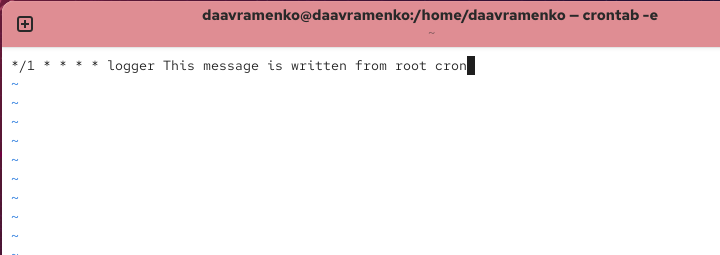
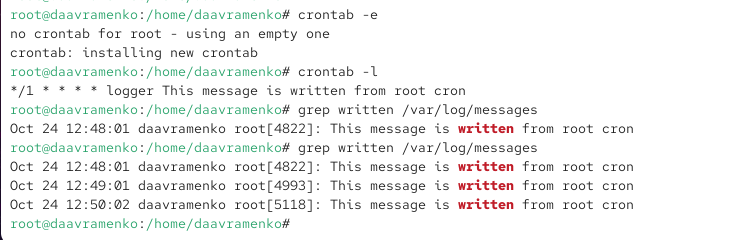
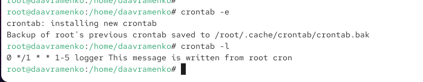
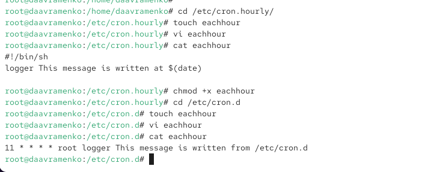
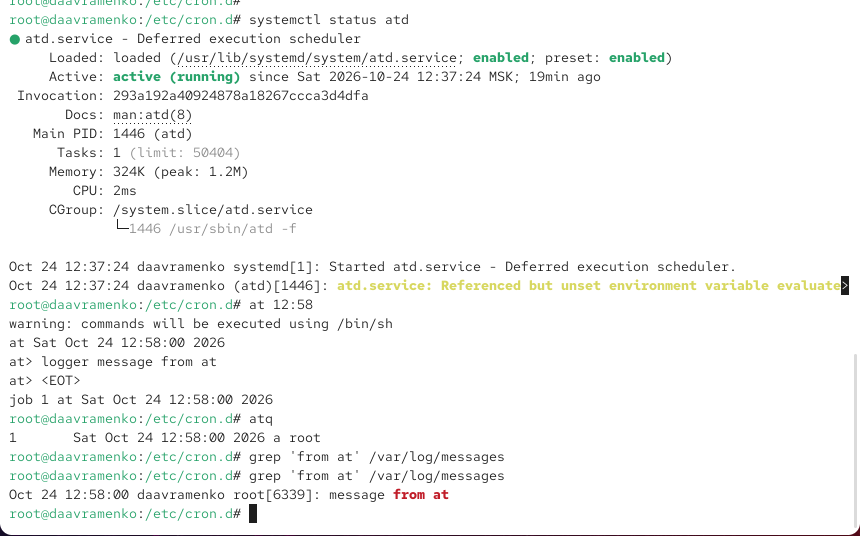

---
## Author
author:
  name: Авраменко Давид Андреевич
  email: 1032251973@rudn.ru
  affiliation:
    - name: Российский университет дружбы народов
      country: Российская Федерация
      postal-code: 117198
      city: Москва
      address: ул. Миклухо-Маклая, д. 6

## Title
title: Лабораторная работа №8
subtitle: Планировщики событий
license: CC BY
date: today
date-format: "YYYY-MM-DD"
---

# Цели и задачи работы

## Цель лабораторной работы

Получить практические навыки планирования и автоматического выполнения заданий в Linux с помощью `cron` и `at`.

Освоить настройку расписаний, управление службами `crond` и `atd`, а также проверку выполнения заданий по системному журналу.

# Процесс выполнения лабораторной работы

## Проверяю состояние службы crond

{ #fig:001 width=70% height=70% }

## Просматриваю конфигурацию crontab и пользовательское расписание

{ #fig:002 width=70% height=70% }

## Создаю задание cron для ежеминутного выполнения

{ #fig:003 width=70% height=70% }

## Проверяю выполнение задания cron по системному журналу

{ #fig:004 width=70% height=70% }

## Изменяю расписание cron для выполнения задания по рабочим дням

{ #fig:005 width=70% height=70% }

## Создаю сценарий eachhour и настраиваю расписание в cron.d

{ #fig:006 width=70% height=70% }

## Проверяю службу atd и планирую однократное выполнение задания

{ #fig:007 width=70% height=70% }

# Выводы по проделанной работе

## Вывод

В ходе лабораторной работы изучены планировщики заданий `cron` и `at`. Настроены расписания периодического выполнения команд, созданы сценарии в `/etc/cron.hourly` и задания в `/etc/cron.d`.

С помощью `at` организовано однократное выполнение команды. Успешность выполнения проверена по записям в системном журнале `/var/log/messages`. Получены навыки автоматизации системных задач в Linux.