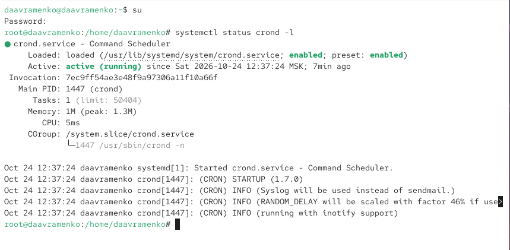
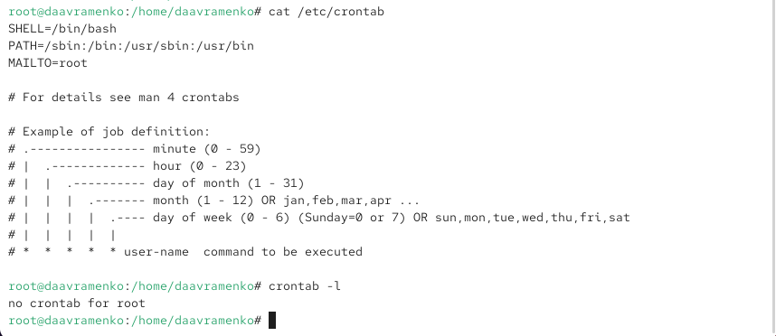

---
## Author
author:
  name: Авраменко Давид Андреевич
  email: 1032251973@rudn.ru
  affiliation:
    - name: Российский университет дружбы народов
      country: Российская Федерация
      postal-code: 117198
      city: Москва
      address: ул. Миклухо-Маклая, д. 6

## Title
title: "Отчёт по лабораторной работе №8"
subtitle: "Планировщики событий"
license: "CC BY"
---

# Цель работы

Получение навыков работы с планировщиками событий cron и at.

# Выполнение лабораторной работы

На виртуальной машине открываю терминал и командой `su` перехожу в режим суперпользователя. Для проверки состояния службы планирования задач выполняю команду `systemctl status crond -l`. В результате получаю информацию о демоне `crond`, который отвечает за автоматическое выполнение заданий по расписанию. В выводе команды отображается состояние `active (running)`, подтверждающее, что служба запущена и работает. Также параметр `enabled` указывает на включённый автоматический запуск службы при загрузке системы. В журнале присутствуют сообщения о запуске демона и использовании системного журнала для регистрации событий (см. рис. [@fig-001]).

{ #fig-001 width=70% }

Для изучения настроек планировщика выполняю команду `cat /etc/crontab`, которая выводит содержимое системного файла расписания. В нём указаны переменные окружения `SHELL=/bin/bash`, определяющая используемую командную оболочку, `PATH`, содержащая пути поиска исполняемых файлов, и `MAILTO=root`, задающая получателя уведомлений о выполнении заданий. Также в файле приведён пример синтаксиса записи расписания, включающий поля минут, часов, дня месяца, месяца, дня недели, имени пользователя и выполняемой команды. Затем выполняю `crontab -l` для просмотра пользовательского расписания суперпользователя. Получаю сообщение `no crontab for root`, указывающее на отсутствие запланированных заданий (см. рис. [@fig-002]).

{ #fig-002 width=70% }

Для создания первого задания выполняю команду `crontab -e`, открывающую расписание в текстовом редакторе `vi`. Перехожу в режим ввода и добавляю строку `*/1 * * * * logger This message is written from root cron`. В данной записи первое поле `*/1` задаёт выполнение задания каждую минуту, а четыре символа `*` обозначают любые значения часа, дня месяца, месяца и дня недели. Команда `logger` записывает сообщение `This message is written from root cron` в системный журнал. Следовательно, созданное задание должно выполняться каждую минуту независимо от времени суток и дня недели. Сохраняю внесённые изменения и закрываю редактор (см. рис. [@fig-003]).

{ #fig-003 width=70% }

После сохранения расписания выполняю команду `crontab -l` и убеждаюсь, что созданная запись присутствует в списке запланированных заданий. Для проверки выполнения задания использую команду `grep written /var/log/messages`, которая выполняет поиск строк, содержащих слово `written`, в журнале системных событий. В результате обнаруживаю сообщение `This message is written from root cron` с отметками времени `12:48:01`, `12:49:01` и `12:50:02`. Появление записей в последовательные минуты подтверждает, что демон `crond` успешно запускает команду `logger` в соответствии с установленным расписанием и сообщения записываются в системный журнал (см. рис. [@fig-004]).

{ #fig-004 width=70% }

Для изменения периодичности выполнения задания повторно открываю расписание командой `crontab -e` и заменяю предыдущую запись на `0 */1 * * 1-5 logger This message is written from root cron`. В данном выражении первое поле `0` обозначает нулевую минуту часа, второе поле `*/1` задаёт выполнение каждый час, третье и четвёртое поля `*` разрешают выполнение в любой день месяца и в любом месяце, а значение `1-5` ограничивает запуск задания рабочими днями с понедельника по пятницу. Следовательно, команда `logger` будет выполняться в начале каждого часа только по будним дням. Сохраняю изменения и выполняю `crontab -l` для проверки расписания. В выводе отображается новая запись, подтверждающая успешное изменение параметров запуска. Также появляется уведомление о сохранении резервной копии предыдущего расписания в файле `/root/.cache/crontab/crontab.bak` (см. рис. [@fig-005]).

{ #fig-005 width=70% }

Для настройки периодического выполнения сценария перехожу в каталог `/etc/cron.hourly/` командой `cd /etc/cron.hourly/` и создаю файл `eachhour` с помощью `touch eachhour`. Открываю созданный файл в редакторе `vi eachhour` и добавляю строки `#!/bin/sh` и `logger This message is written at $(date)`. Первая строка определяет командную оболочку `/bin/sh`, используемую для выполнения сценария, а вторая записывает сообщение в системный журнал. Конструкция `$(date)` подставляет текущие дату и время в текст сообщения. Проверяю содержимое файла командой `cat eachhour`, после чего выполняю `chmod +x eachhour`, предоставляя сценарию права на выполнение. Затем перехожу в каталог `/etc/cron.d` командой `cd /etc/cron.d` и создаю отдельный файл расписания `eachhour` с помощью `touch eachhour`. Открываю его командой `vi eachhour` и добавляю строку `11 * * * * root logger This message is written from /etc/cron.d`. В данной записи значение `11` обозначает одиннадцатую минуту каждого часа, а символы `*` разрешают выполнение в любой час, день месяца, месяц и день недели. Поле `root` указывает пользователя, от имени которого должна выполняться команда. Следовательно, сообщение `This message is written from /etc/cron.d` должно записываться в системный журнал ежечасно в 11 минут. Проверяю содержимое файла командой `cat eachhour` и убеждаюсь в правильности созданного расписания. Сценарий в `/etc/cron.hourly` и задание в `/etc/cron.d` настроены, однако подтверждение их фактического выполнения спустя несколько часов на представленных скриншотах отсутствует (см. рис. [@fig-006]).

{ #fig-006 width=70% }

Для изучения однократного выполнения отложенных заданий с помощью `at` проверяю состояние соответствующей службы командой `systemctl status atd`. В результате получаю информацию о службе `atd.service`, которая находится в состоянии `active (running)` и имеет параметр `enabled`, подтверждающий её запуск и включённую автозагрузку. Затем выполняю команду `at 12:58`, указывая время однократного выполнения задания. В открывшемся интерактивном режиме ввожу `logger message from at`, после чего завершаю ввод сочетанием клавиш `Ctrl + D`. Планировщик сообщает о создании задания `job 1 at Sat Oct 24 12:58:00 2026`. Для проверки очереди запланированных заданий выполняю команду `atq`, которая отображает задание с номером `1`, временем запуска `12:58:00` и пользователем `root`. После наступления указанного времени выполняю команду `grep 'from at' /var/log/messages` для поиска сообщения в системном журнале. При первой проверке соответствующая запись отсутствует, однако повторный запуск команды показывает сообщение `Oct 24 12:58:00 daavramenko root[6339]: message from at`. Полученный результат подтверждает успешное однократное выполнение запланированной команды в установленное время. В отличие от `cron`, предназначенного для периодического выполнения заданий, планировщик `at` позволяет запускать команды однократно в заранее указанное время (см. рис. [@fig-007]).

{ #fig-007 width=70% }

# Вывод

В ходе лабораторной работы были изучены способы автоматического выполнения заданий в операционной системе Linux с использованием планировщиков `cron` и `at`. Проверено состояние служб `crond` и `atd`, а также рассмотрены основные конфигурационные файлы и команды для управления расписанием задач.

С помощью команды `crontab -e` созданы и изменены задания для периодической записи сообщений в системный журнал. Настроено выполнение команд каждую минуту и каждый час по рабочим дням. Также создан исполняемый сценарий `eachhour` в каталоге `/etc/cron.hourly` и дополнительное расписание в `/etc/cron.d`. Успешное выполнение ежеминутного задания подтверждено записями в файле `/var/log/messages`.

Для изучения однократного планирования заданий использована утилита `at`. Создано задание для выполнения команды `logger` в установленное время, проверено его наличие в очереди с помощью `atq` и подтверждено успешное выполнение по системному журналу.

В результате работы были получены практические навыки настройки расписания, управления службами планирования и проверки выполнения автоматизированных заданий в Linux.

# Контрольные вопросы

1. Как настроить задание cron, чтобы оно выполнялось раз в 2 недели?

Стандартный синтаксис `cron` не позволяет непосредственно задать период выполнения ровно в 14 дней, поскольку расписание определяется календарными полями.

Для выполнения задания раз в две недели можно использовать еженедельный запуск с дополнительной проверкой номера двухнедельного периода:

`0 2 * * 1 [ $(( $(date +\%s) / 604800 \% 2 )) -eq 0 ] && /usr/local/bin/task.sh`

В данной записи:

- `0` — нулевая минута;
- `2` — два часа ночи;
- `* *` — любой день месяца и любой месяц;
- `1` — понедельник;
- `date +\%s` — получение количества секунд с начала эпохи Unix;
- `604800` — количество секунд в одной неделе;
- `% 2` — проверка чётности номера недельного периода.

В результате задание выполняется в 02:00 каждый второй понедельник с интервалом в 14 дней. Символ `%` экранируется обратной косой чертой, поскольку в файле `crontab` он имеет специальное значение.

2. Как настроить задание cron, чтобы оно выполнялось 1-го и 15-го числа каждого месяца в 2 часа ночи?

Для выполнения задания первого и пятнадцатого числа каждого месяца в 02:00 необходимо добавить в `crontab` следующую запись:

`0 2 1,15 * * /usr/local/bin/task.sh`

Значения полей:

- `0` — нулевая минута;
- `2` — два часа ночи;
- `1,15` — первое и пятнадцатое числа месяца;
- `*` — любой месяц;
- `*` — любой день недели.

Запятая позволяет перечислить несколько значений одного поля. В результате задание будет выполняться два раза в месяц в 02:00.

3. Как настроить задание cron, чтобы оно выполнялось каждые 2 минуты каждый день?

Для выполнения задания каждые две минуты используется запись:

`*/2 * * * * /usr/local/bin/task.sh`

В данной записи:

- `*/2` — выполнение каждые две минуты;
- `*` — любой час;
- `*` — любой день месяца;
- `*` — любой месяц;
- `*` — любой день недели.

Символ `*` обозначает все допустимые значения поля, а конструкция `*/2` задаёт шаг выполнения, равный двум.

Задание будет запускаться в 00, 02, 04, 06 и последующие чётные минуты каждого часа ежедневно.

4. Как настроить задание cron, чтобы оно выполнялось 19 сентября ежегодно?

Для выполнения задания ежегодно 19 сентября в 00:00 используется запись:

`0 0 19 9 * /usr/local/bin/task.sh`

Значения полей:

- `0` — нулевая минута;
- `0` — полночь;
- `19` — девятнадцатое число месяца;
- `9` — сентябрь;
- `*` — любой день недели.

Задание будет автоматически выполняться 19 сентября каждого года в 00:00.

5. Как настроить задание cron, чтобы оно выполнялось каждый четверг сентября ежегодно?

Для выполнения задания каждый четверг сентября в 00:00 используется запись:

`0 0 * 9 4 /usr/local/bin/task.sh`

Значения полей:

- `0` — нулевая минута;
- `0` — полночь;
- `*` — любой день месяца;
- `9` — сентябрь;
- `4` — четверг.

В расписании `cron` дни недели обозначаются числами от `0` до `7`, где `0` и `7` соответствуют воскресенью, а `4` — четвергу.

В результате задание будет выполняться каждый четверг сентября независимо от числа месяца.

6. Какая команда позволяет вам назначить задание cron для пользователя alice? Приведите подтверждающий пример.

Для назначения задания определённому пользователю применяется команда:

`crontab -u alice -e`

Параметр `-u` позволяет указать пользователя, расписание которого необходимо изменить, а параметр `-e` открывает файл расписания для редактирования.

Например, для ежедневного выполнения команды `logger` от имени пользователя `alice` в 10:00 можно добавить запись:

`0 10 * * * logger Task executed by alice`

После сохранения расписания его содержимое можно проверить командой:

`crontab -u alice -l`

В результате должна отображаться добавленная запись:

`0 10 * * * logger Task executed by alice`

Для редактирования расписания другого пользователя необходимы соответствующие административные полномочия. Выполнение команды от имени суперпользователя позволяет назначать задания пользователям системы.

7. Как указать, что пользователю bob никогда не разрешено назначать задания через cron? Приведите подтверждающий пример.

Для ограничения доступа пользователей к созданию заданий `cron` используются файлы:

`/etc/cron.allow`

`/etc/cron.deny`

Файл `/etc/cron.allow` содержит список пользователей, которым разрешено использовать команду `crontab`.

Файл `/etc/cron.deny` содержит список пользователей, которым запрещено использовать эту команду.

Если файл `/etc/cron.allow` отсутствует, для запрета пользователю `bob` можно добавить его имя в `/etc/cron.deny`:

`echo bob >> /etc/cron.deny`

Проверить содержимое файла можно командой:

`cat /etc/cron.deny`

В выводе должно присутствовать имя:

`bob`

После этого пользователь `bob` при попытке выполнить команду `crontab -e` получит отказ в доступе.

Если файл `/etc/cron.allow` существует, он имеет приоритет перед `/etc/cron.deny`. В этом случае необходимо убедиться, что имя `bob` отсутствует в списке разрешённых пользователей.

Следует учитывать, что данные ограничения запрещают управление заданиями через `crontab`, но не останавливают уже существующие задания пользователя. Для удаления имеющегося расписания администратор может выполнить:

`crontab -u bob -r`

8. Вам нужно убедиться, что задание выполняется каждый день, даже если сервер во время выполнения временно недоступен. Как это сделать?

Для выполнения периодических заданий с учётом временной недоступности сервера можно использовать планировщик `anacron`.

В отличие от обычного `cron`, который пропускает задания, если система была выключена в запланированное время, `anacron` проверяет дату последнего выполнения и запускает просроченные задания после возобновления работы системы.

Основной конфигурационный файл `anacron` располагается по пути:

`/etc/anacrontab`

Для настройки ежедневного задания можно добавить следующую строку:

`1 5 daily-task /usr/local/bin/task.sh`

В данной записи:

- `1` — период выполнения в один день;
- `5` — задержка запуска на пять минут;
- `daily-task` — уникальное имя задания;
- `/usr/local/bin/task.sh` — исполняемый сценарий.

Если сервер был выключен во время запланированного выполнения, `anacron` обнаружит пропущенный запуск при следующей проверке и выполнит задание после указанной задержки.

При этом `anacron` не запускает задание отдельно за каждый пропущенный день, а обеспечивает выполнение просроченного задания после восстановления работы системы.

9. Какая команда позволяет узнать, запланированы ли какие-либо задания на выполнение планировщиком atd?

Для просмотра очереди заданий, запланированных с помощью `at`, используется команда:

`atq`

Она выводит список ожидающих выполнения заданий с указанием их идентификаторов, времени запуска и пользователей.

Альтернативная команда:

`at -l`

Например, результат выполнения `atq` может выглядеть следующим образом:

`1 Sat Oct 24 12:58:00 2026 a root`

Здесь:

- `1` — идентификатор задания;
- `Sat Oct 24 12:58:00 2026` — запланированная дата и время выполнения;
- `a` — очередь задания;
- `root` — пользователь, от имени которого будет выполнено задание.

Если очередь пуста, команда `atq` не выводит никаких записей.

Для удаления запланированного задания по его идентификатору используется команда:

`atrm 1`

После успешного выполнения однократное задание автоматически удаляется из очереди планировщика `atd`.

# Список литературы

1. Немет Э., Снайдер Г., Хейн Т., Уэйли Б., Макин Д. [UNIX and Linux System Administration Handbook](https://www.pearson.com/en-us/subject-catalog/p/Nemeth-UNIX-and-Linux-System-Administration-Handbook-5th-Edition/P200000000513). — 5-е изд. — Addison-Wesley Professional, 2017.

2. Уорд Б. [How Linux Works: What Every Superuser Should Know](https://nostarch.com/howlinuxworks3/). — 3-е изд. — No Starch Press, 2021.

3. Керриск М. [The Linux Programming Interface: A Linux and UNIX System Programming Handbook](https://nostarch.com/linuxprogramming). — No Starch Press, 2010.

4. Red Hat, Inc. [Red Hat Enterprise Linux 7. System Administrator's Guide. Chapter 24. Automating System Tasks](https://docs.redhat.com/en/documentation/red_hat_enterprise_linux/7/html/system_administrators_guide/ch-automating_system_tasks). — Электронная документация Red Hat.

5. Linux man-pages. [crontab(5) — Files Used to Schedule the Execution of Programs](https://man7.org/linux/man-pages/man5/crontab.5.html). — Справочное руководство по синтаксису файлов расписания cron.

6. Linux man-pages. [crontab(1) — Maintains Crontab Files for Individual Users](https://man7.org/linux/man-pages/man1/crontab.1.html). — Справочное руководство по управлению пользовательскими заданиями cron.

7. Linux man-pages. [anacrontab(5) — Configuration File for Anacron](https://man7.org/linux/man-pages/man5/anacrontab.5.html). — Справочное руководство по настройке периодических заданий с учётом пропущенных запусков.
