---
## Author
author:
  name: Авраменко Давид Андреевич
  email: 1032251973@rudn.ru
  affiliation:
    - name: Российский университет дружбы народов
      country: Российская Федерация
      postal-code: 117198
      city: Москва
      address: ул. Миклухо-Маклая, д. 6

## Title
title: Лабораторная работа №9
subtitle: Управление SELinux
license: CC BY
date: today
date-format: "YYYY-MM-DD"
---

# Цели и задачи работы

## Цель лабораторной работы

Получить практические навыки управления механизмом безопасности SELinux в операционной системе Linux.

Освоить переключение режимов SELinux, восстановление контекстов безопасности файлов, настройку доступа веб-сервера к нестандартным каталогам и управление переключателями SELinux.

# Процесс выполнения лабораторной работы

## Проверяю состояние SELinux и текущую политику безопасности

{ #fig:001 width=70% height=70% }

## Переключаю SELinux из режима Enforcing в Permissive

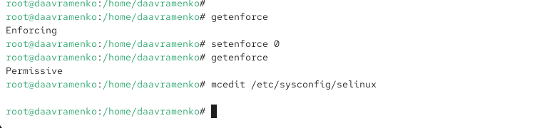{ #fig:002 width=70% height=70% }

## Отключаю SELinux через конфигурационный файл

{ #fig:003 width=70% height=70% }

## Проверяю отключение SELinux и попытку изменения режима

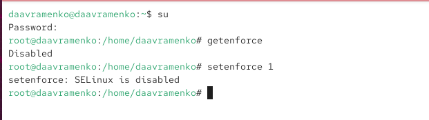{ #fig:004 width=70% height=70% }

## Восстанавливаю принудительный режим SELinux

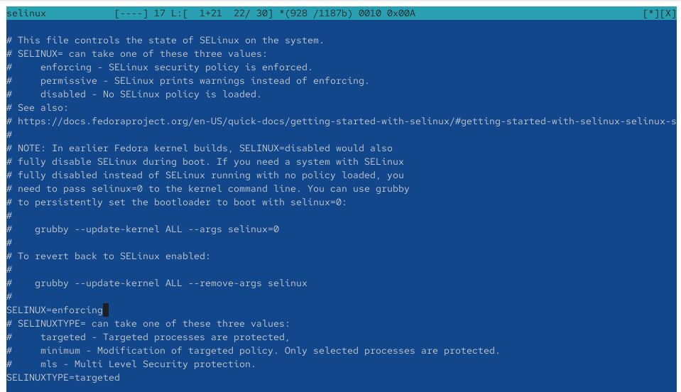{ #fig:005 width=70% height=70% }

## Наблюдаю восстановление меток безопасности при загрузке

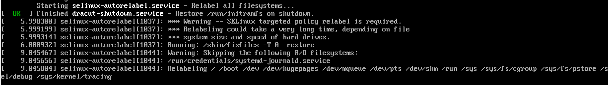{ #fig:006 width=70% height=70% }

## Проверяю состояние SELinux после повторного включения

{ #fig:007 width=70% height=70% }

## Изменяю и восстанавливаю контекст безопасности файла hosts

{ #fig:008 width=70% height=70% }

## Запускаю автоматическую перемаркировку файловой системы

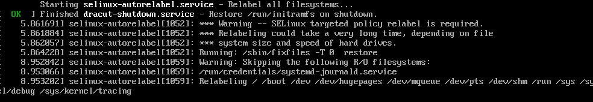{ #fig:009 width=70% height=70% }

## Создаю каталог web и пользовательскую веб-страницу

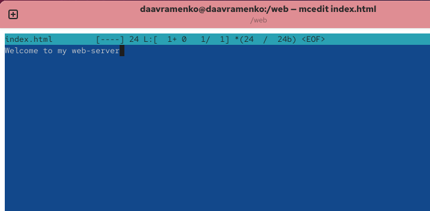{ #fig:010 width=70% height=70% }

## Настраиваю корневой каталог и правила доступа Apache

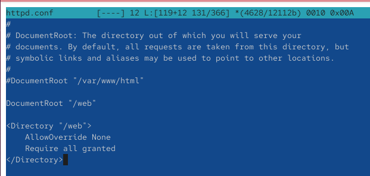{ #fig:011 width=70% height=70% }

## Проверяю содержимое веб-страницы и запускаю службу httpd

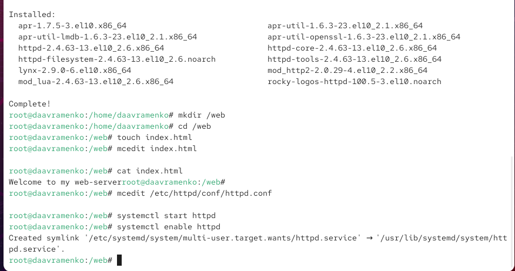{ #fig:012 width=70% height=70% }

## Проверяю работу веб-сервера до изменения контекста SELinux

{ #fig:013 width=70% height=70% }

## Назначаю контекст безопасности httpd_sys_content_t каталогу web

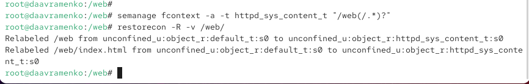{ #fig:014 width=70% height=70% }

## Проверяю доступность пользовательской веб-страницы

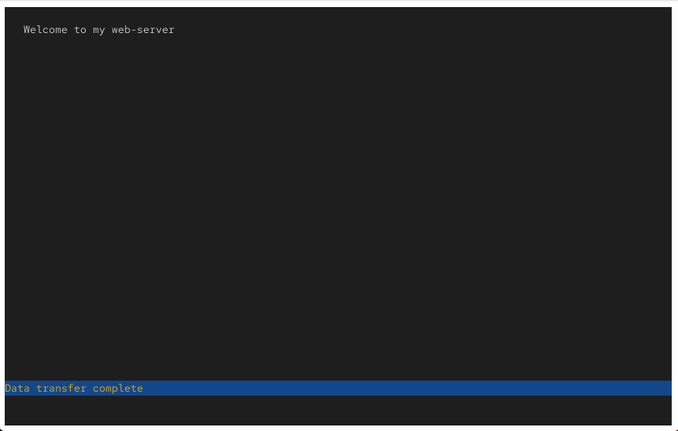{ #fig:015 width=70% height=70% }

## Изучаю и изменяю переключатели SELinux для FTP

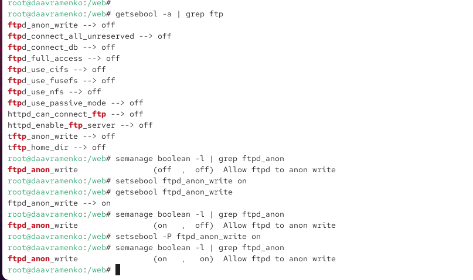{ #fig:016 width=70% height=70% }

# Выводы по проделанной работе

## Вывод

В ходе лабораторной работы изучены основные механизмы управления SELinux. Выполнено переключение между режимами `Enforcing`, `Permissive` и `Disabled`, а также восстановление контекстов безопасности с помощью `restorecon`.

Настроено нестандартное расположение файлов веб-сервера Apache в каталоге `/web`. С использованием `semanage fcontext` назначен контекст `httpd_sys_content_t`, после чего проверена доступность пользовательской веб-страницы.

Также изучено управление переключателями SELinux на примере `ftpd_anon_write`. Получены практические навыки настройки политик безопасности, управления доступом к файлам и диагностики ограничений SELinux в Linux.