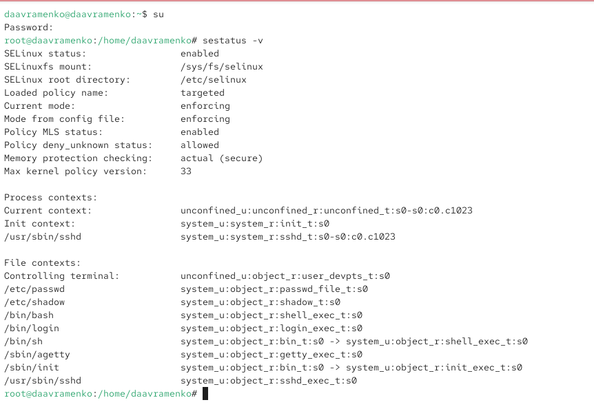
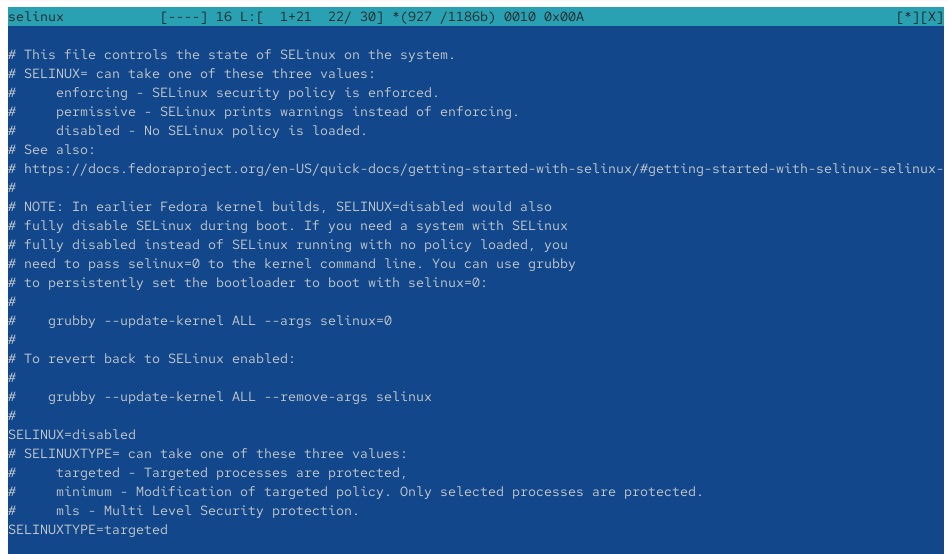
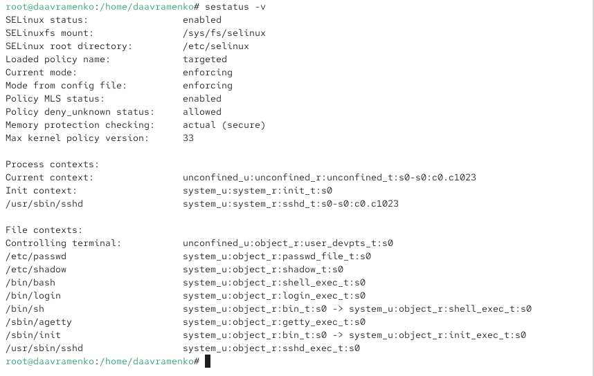
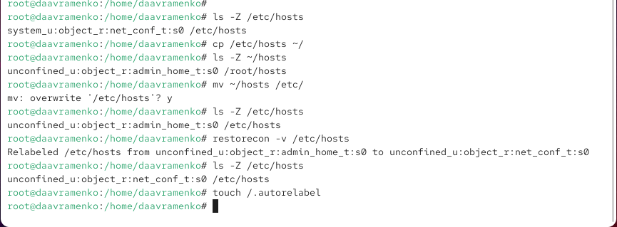
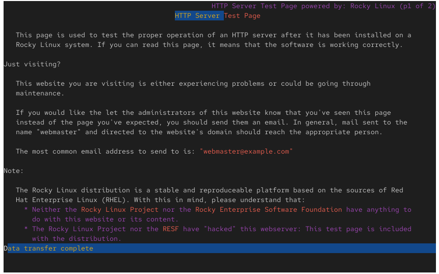

---
## Author
author:
  name: Авраменко Давид Андреевич
  email: 1032251973@rudn.ru
  affiliation:
    - name: Российский университет дружбы народов
      country: Российская Федерация
      postal-code: 117198
      city: Москва
      address: ул. Миклухо-Маклая, д. 6

## Title
title: "Отчёт по лабораторной работе №9"
subtitle: "Управление SELinux"
license: "CC BY"
---

# Цель работы

Получить навыки работы с контекстом безопасности и политиками SELinux.

# Выполнение лабораторной работы

На виртуальной машине открываю терминал и командой `su` получаю права суперпользователя. Выполняю `sestatus -v` для просмотра состояния SELinux. В выводе `SELinux status: enabled` означает, что SELinux включён, `SELinuxfs mount` указывает точку монтирования, а `SELinux root directory` — каталог конфигурации. Параметр `Loaded policy name: targeted` обозначает используемую политику. Строки `Current mode: enforcing` и `Mode from config file: enforcing` подтверждают принудительный режим работы. `Policy MLS status: enabled` указывает на поддержку многоуровневой безопасности, `Policy deny_unknown status: allowed` — разрешение неизвестных политике действий, `Memory protection checking: actual (secure)` — режим проверки защиты памяти, а `Max kernel policy version: 33` — максимальную поддерживаемую версию политики. В разделах `Process contexts` и `File contexts` отображаются контексты безопасности процессов и файлов, состоящие из пользователя, роли, типа и уровня безопасности (см. рис. [@fig-001]).

{ #fig-001 width=70% }

Для проверки текущего режима выполняю `getenforce` и получаю значение `Enforcing`. Командой `setenforce 0` переключаю SELinux в разрешающий режим, при котором нарушения политики регистрируются, но не блокируются. Повторная команда `getenforce` возвращает `Permissive`, подтверждая изменение режима. Затем открываю конфигурационный файл командой `mcedit /etc/sysconfig/selinux` для изменения постоянных настроек (см. рис. [@fig-002]).

{ #fig-002 width=70% }

В конфигурационном файле `/etc/sysconfig/selinux` изменяю параметр на `SELINUX=disabled`, отключающий SELinux после перезагрузки. Параметр `SELINUXTYPE=targeted`, определяющий используемую политику безопасности, оставляю без изменений. Сохраняю файл и перезагружаю систему для применения настроек (см. рис. [@fig-003]).

{ #fig-003 width=70% }

После перезагрузки получаю права администратора и выполняю `getenforce`. Получаю значение `Disabled`, подтверждающее отключение SELinux. Затем пытаюсь включить принудительный режим командой `setenforce 1`, однако система выводит `setenforce: SELinux is disabled`. Это означает, что переключение из отключённого состояния невозможно без изменения конфигурации и перезагрузки системы (см. рис. [@fig-004]).

{ #fig-004 width=70% }

Для повторного включения SELinux открываю файл `/etc/sysconfig/selinux` и устанавливаю `SELINUX=enforcing`. Данный параметр задаёт принудительное применение политики безопасности. Сохраняю изменения и перезагружаю виртуальную машину для активации SELinux (см. рис. [@fig-005]).

{ #fig-005 width=70% }

Во время загрузки системы появляется сообщение `SELinux targeted policy relabel is required`, указывающее на необходимость восстановления меток безопасности. Служба `selinux-autorelabel.service` запускает автоматическую перемаркировку файловой системы. Также отображается предупреждение о возможной продолжительности процедуры. Восстановление меток необходимо для корректной работы SELinux после повторного включения (см. рис. [@fig-006]).

{ #fig-006 width=70% }

После перезагрузки выполняю `sestatus -v` и проверяю состояние SELinux. Строка `SELinux status: enabled` подтверждает включение механизма безопасности, а значения `Current mode: enforcing` и `Mode from config file: enforcing` указывают на принудительный режим работы. Также отображаются сведения о политике `targeted` и контекстах системных процессов и файлов. Следовательно, SELinux успешно восстановлен (см. рис. [@fig-007]).

{ #fig-007 width=70% }

Для изучения восстановления контекстов выполняю `ls -Z /etc/hosts` и определяю тип безопасности файла `net_conf_t`. Затем копирую его командой `cp /etc/hosts ~/` и проверяю `ls -Z ~/hosts`. У копии устанавливается тип `admin_home_t`, соответствующий домашнему каталогу администратора. Командой `mv ~/hosts /etc/` перемещаю файл обратно, подтверждаю перезапись и проверяю, что контекст остался `admin_home_t`. Для исправления выполняю `restorecon -v /etc/hosts`, после чего тип изменяется на `net_conf_t`. Повторная проверка подтверждает восстановление метки. Затем создаю файл `/.autorelabel` командой `touch /.autorelabel` для массового восстановления контекстов при перезагрузке (см. рис. [@fig-008]).

{ #fig-008 width=70% }

После создания файла `/.autorelabel` перезагружаю систему. Во время загрузки запускается служба `selinux-autorelabel.service`, выполняющая автоматическое восстановление контекстов безопасности. В выводе отображаются сообщение `SELinux targeted policy relabel is required` и строки `Relabeling`, указывающие на обработку файловой системы. Это подтверждает запуск массовой перемаркировки файлов (см. рис. [@fig-009]).

{ #fig-009 width=70% }

Для настройки нестандартного расположения файлов веб-сервера устанавливаю Apache и текстовый браузер Lynx командами `dnf -y install httpd` и `dnf -y install lynx`. Затем создаю каталог `/web` командой `mkdir /web`, перехожу в него с помощью `cd /web` и создаю файл `touch index.html`. Открываю файл в редакторе `mcedit index.html`, добавляю строку `Welcome to my web-server` и сохраняю изменения (см. рис. [@fig-010]).

{ #fig-010 width=70% }

Для изменения корневого каталога Apache открываю файл `/etc/httpd/conf/httpd.conf`. Комментирую стандартную директиву `DocumentRoot "/var/www/html"` и добавляю `DocumentRoot "/web"`. Также настраиваю раздел `<Directory "/web">`, указывая `AllowOverride None` и `Require all granted`. Эти параметры разрешают Apache обслуживать файлы из каталога `/web`, однако доступ к ним дополнительно контролируется SELinux. Сохраняю конфигурацию (см. рис. [@fig-011]).

{ #fig-011 width=70% }

После настройки проверяю содержимое созданного файла командой `cat index.html` и получаю строку `Welcome to my web-server`. Затем запускаю веб-сервер командой `systemctl start httpd` и включаю его автоматический запуск с помощью `systemctl enable httpd`. Сообщение о создании символической ссылки подтверждает успешное включение службы в автозагрузку (см. рис. [@fig-012]).

{ #fig-012 width=70% }

Для проверки работы веб-сервера выполняю `lynx http://localhost`. Вместо созданной страницы отображается стандартная тестовая страница Rocky Linux `HTTP Server Test Page`. Причиной является отсутствие подходящего контекста безопасности у файлов каталога `/web`. SELinux блокирует доступ Apache к файлам с типом `default_t`, несмотря на разрешения, установленные в конфигурации веб-сервера (см. рис. [@fig-013]).

{ #fig-013 width=70% }

Для исправления контекста выполняю `semanage fcontext -a -t httpd_sys_content_t "/web(/.*)?"`. Команда добавляет постоянное правило назначения типа `httpd_sys_content_t` каталогу `/web` и его содержимому. Затем выполняю `restorecon -R -v /web`, применяя новые метки рекурсивно. В выводе отображается изменение типа безопасности каталога и файла `index.html` с `default_t` на `httpd_sys_content_t`, разрешающий Apache читать статические веб-файлы (см. рис. [@fig-014]).

{ #fig-014 width=70% }

После изменения контекстов повторно выполняю `lynx http://localhost`. Теперь браузер отображает строку `Welcome to my web-server`, соответствующую содержимому файла `/web/index.html`. Сообщение `Data transfer complete` подтверждает успешную передачу данных. Следовательно, после назначения правильного контекста безопасности веб-сервер получил доступ к файлам нестандартного каталога (см. рис. [@fig-015]).

{ #fig-015 width=70% }

Для изучения переключателей SELinux выполняю `getsebool -a | grep ftp`, получая список параметров, связанных с FTP. Переключатель `ftpd_anon_write` имеет значение `off`. Командой `semanage boolean -l | grep ftpd_anon` проверяю его текущее и постоянное состояния, получая `(off, off)`. Затем выполняю `setsebool ftpd_anon_write on` и проверяю результат командами `getsebool ftpd_anon_write` и `semanage boolean -l | grep ftpd_anon`. Получаю `(on, off)`, что означает временное включение переключателя без изменения постоянной настройки. Для сохранения параметра выполняю `setsebool -P ftpd_anon_write on`. Повторная проверка показывает `(on, on)`, подтверждая, что переключатель включён и его состояние сохранится после перезагрузки системы (см. рис. [@fig-016]).

{ #fig-016 width=70% }

# Вывод

В ходе лабораторной работы были изучены основные механизмы управления SELinux в операционной системе Linux. Рассмотрены режимы работы `Enforcing`, `Permissive` и `Disabled`, а также способы их изменения с помощью команд `getenforce`, `setenforce` и конфигурационного файла `/etc/sysconfig/selinux`.

С помощью команды `restorecon` выполнено восстановление контекста безопасности файла `/etc/hosts`. Также изучена процедура автоматической перемаркировки файловой системы с использованием файла `/.autorelabel`.

Для настройки нестандартного расположения файлов веб-сервера Apache создан каталог `/web`. С помощью команд `semanage fcontext` и `restorecon` файлам назначен тип безопасности `httpd_sys_content_t`, после чего проверена доступность пользовательской веб-страницы через браузер Lynx.

Также изучены переключатели SELinux. На примере `ftpd_anon_write` выполнено временное и постоянное изменение значения с помощью команды `setsebool`.

В результате работы получены практические навыки управления режимами SELinux, восстановления контекстов безопасности, настройки доступа служб к файлам и изменения параметров политики безопасности.

# Контрольные вопросы

1. **Вы хотите временно поставить SELinux в разрешающий режим. Какую команду вы используете?**

Для временного переключения SELinux в разрешающий режим необходимо выполнить команду:

`setenforce 0`

В режиме `Permissive` SELinux регистрирует нарушения политики безопасности, но не блокирует действия. Проверить текущий режим можно командой `getenforce`.

Изменение действует до перезагрузки системы и не изменяет постоянную конфигурацию.

2. **Вам нужен список всех доступных переключателей SELinux. Какую команду вы используете?**

Для просмотра всех переключателей SELinux необходимо выполнить команду:

`getsebool -a`

Параметр `-a` выводит полный список переключателей с их текущими состояниями `on` или `off`.

Для просмотра подробных описаний переключателей используется команда `semanage boolean -l`.

3. **Каково имя пакета, который требуется установить для получения легко читаемых сообщений журнала SELinux в журнале аудита?**

Для получения понятных сообщений о нарушениях политики SELinux необходимо установить пакет `setroubleshoot-server`:

`dnf install setroubleshoot-server`

Пакет предоставляет инструменты анализа событий SELinux. Утилита `sealert` позволяет получать подробные объяснения ошибок и рекомендации по их устранению. Упрощённые сообщения могут записываться в `/var/log/messages`, а исходные события аудита — в `/var/log/audit/audit.log`.

4. **Какие команды вам нужно выполнить, чтобы применить тип контекста httpd_sys_content_t к каталогу /web?**

Для назначения контекста безопасности необходимо выполнить две команды:

`semanage fcontext -a -t httpd_sys_content_t "/web(/.*)?"`

`restorecon -R -v /web`

Первая команда добавляет постоянное правило назначения типа `httpd_sys_content_t` каталогу `/web` и его содержимому.

Вторая команда рекурсивно применяет заданный контекст ко всем существующим файлам и подкаталогам. Тип `httpd_sys_content_t` позволяет веб-серверу Apache читать статический веб-контент.

5. **Какой файл вам нужно изменить, если вы хотите полностью отключить SELinux?**

Для полного отключения SELinux необходимо изменить конфигурационный файл:

`/etc/sysconfig/selinux`

В нём требуется установить параметр:

`SELINUX=disabled`

После сохранения изменений необходимо перезагрузить систему командой `reboot`. Проверить результат можно с помощью `getenforce`, которая должна вернуть значение `Disabled`.

6. **Где SELinux регистрирует все свои сообщения?**

Основным местом регистрации событий безопасности SELinux является файл:

`/var/log/audit/audit.log`

В нём служба `auditd` сохраняет события аудита, включая сообщения `AVC` о блокировках доступа.

Для просмотра сообщений SELinux можно выполнить команду:

`ausearch -m AVC,USER_AVC -ts recent`

Дополнительные сообщения могут отображаться в `/var/log/messages` и системном журнале `journald`.

7. **Вы не знаете, какие типы контекстов доступны для службы ftp. Какая команда позволяет получить более конкретную информацию?**

Для поиска документации SELinux, связанной с FTP, используется команда:

`man -k _selinux | grep ftp`

Команда выводит список доступных справочных страниц SELinux, относящихся к FTP-службе.

Для получения подробной информации о политике безопасности FTP можно открыть соответствующее руководство:

`man ftpd_selinux`

В нём описываются доступные типы контекстов безопасности, переключатели и разрешённые операции FTP-службы.

8. **Ваш сервис работает не так, как ожидалось, и вы хотите узнать, связано ли это с SELinux или чем-то ещё. Какой самый простой способ узнать?**

Самый простой способ — временно перевести SELinux в разрешающий режим командой:

`setenforce 0`

После этого необходимо повторить действие, которое ранее вызывало ошибку.

Если сервис начинает работать корректно, вероятной причиной проблемы являются ограничения политики SELinux. Если ошибка сохраняется, её причина, скорее всего, связана с другими настройками системы.

После проверки необходимо вернуть принудительный режим командой:

`setenforce 1`

Дополнительно можно изучить сообщения о блокировках с помощью `ausearch -m AVC -ts recent`.

# Список литературы

1. Вермеулен С. [SELinux System Administration](https://www.packtpub.com/en-PL/product/selinux-system-administration-third-edition-9781800201477). — 3-е изд. — Packt Publishing, 2020.

2. Red Hat, Inc. [Red Hat Enterprise Linux 9. Using SELinux. Chapter 2. Changing SELinux States and Modes](https://docs.redhat.com/en/documentation/red_hat_enterprise_linux/9/html/using_selinux/changing-selinux-states-and-modes_using-selinux). — Электронная документация по управлению режимами работы SELinux.

3. Red Hat, Inc. [Red Hat Enterprise Linux 9. Using SELinux. Chapter 4. Configuring SELinux for Applications and Services with Non-standard Configurations](https://docs.redhat.com/en/documentation/red_hat_enterprise_linux/9/html/using_selinux/configuring-selinux-for-applications-and-services-with-non-standard-configurations_using-selinux). — Руководство по настройке контекстов безопасности и переключателей SELinux.

4. Red Hat, Inc. [Red Hat Enterprise Linux 9. Using SELinux. Chapter 5. Troubleshooting Problems Related to SELinux](https://docs.redhat.com/en/documentation/red_hat_enterprise_linux/9/html/using_selinux/troubleshooting-problems-related-to-selinux_using-selinux). — Руководство по диагностике ошибок и анализу сообщений SELinux.

5. Linux man-pages. [restorecon(8) — Restore File(s) Default SELinux Security Contexts](https://man7.org/linux/man-pages/man8/restorecon.8.html). — Справочное руководство по восстановлению контекстов безопасности файлов и каталогов.

6. Linux man-pages. [semanage-fcontext(8) — SELinux Policy Management File Context Tool](https://man7.org/linux/man-pages/man8/semanage-fcontext.8.html). — Справочное руководство по управлению правилами назначения контекстов безопасности SELinux.