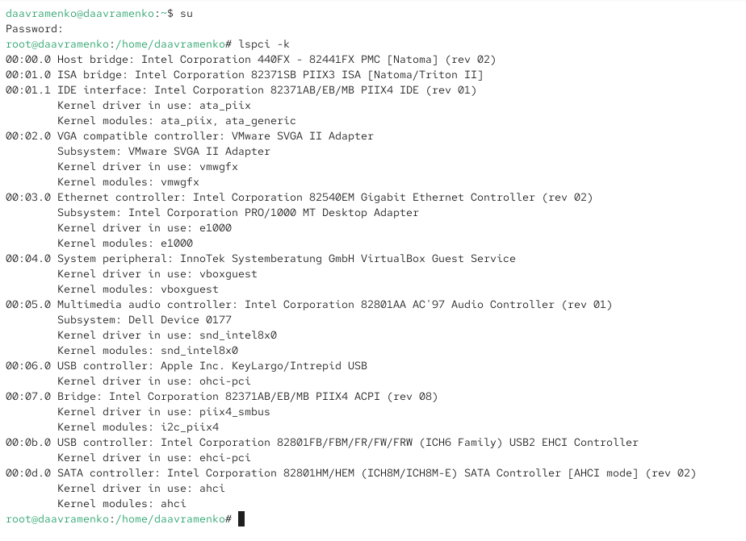
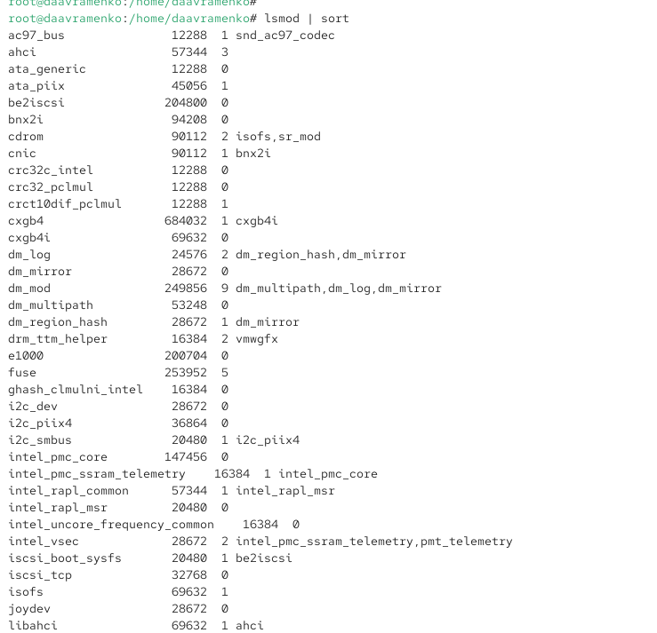
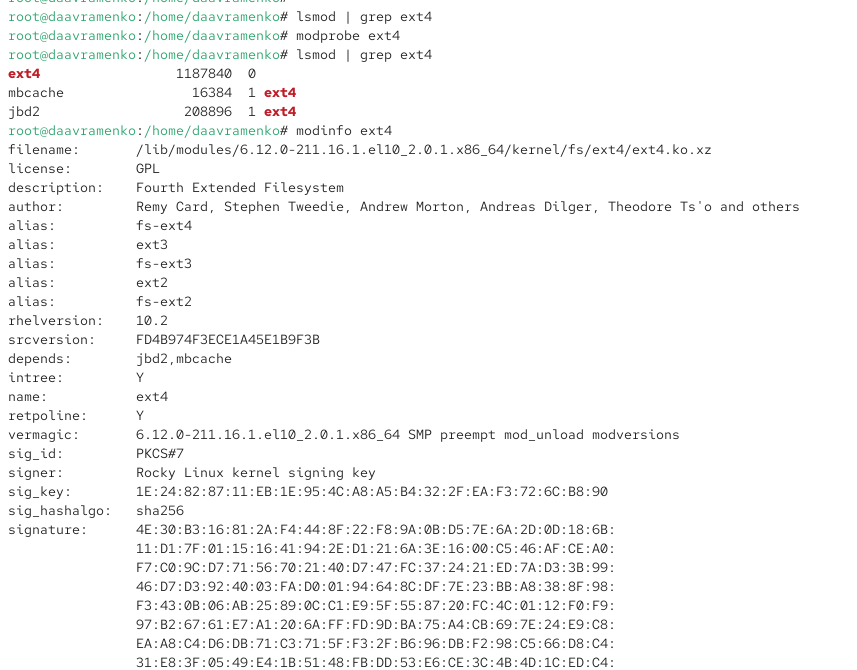
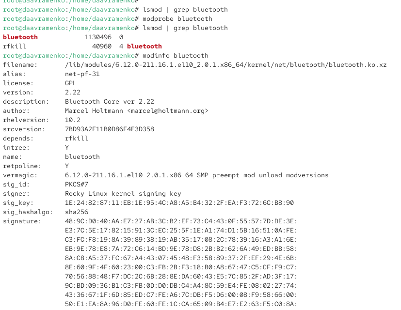
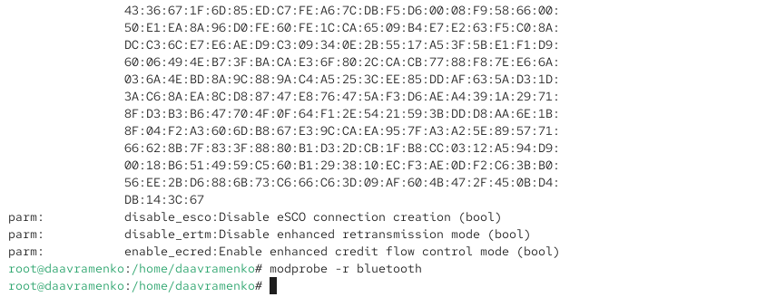
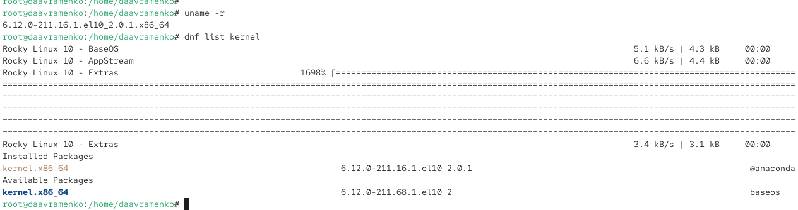
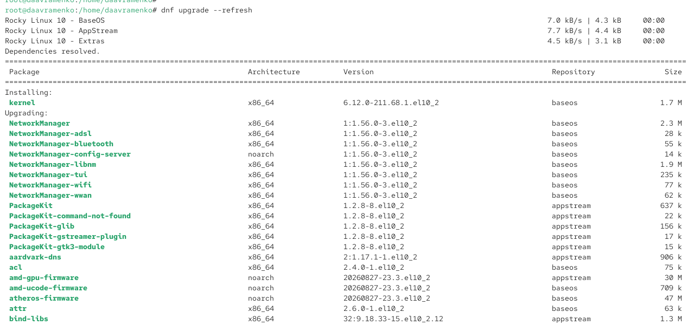
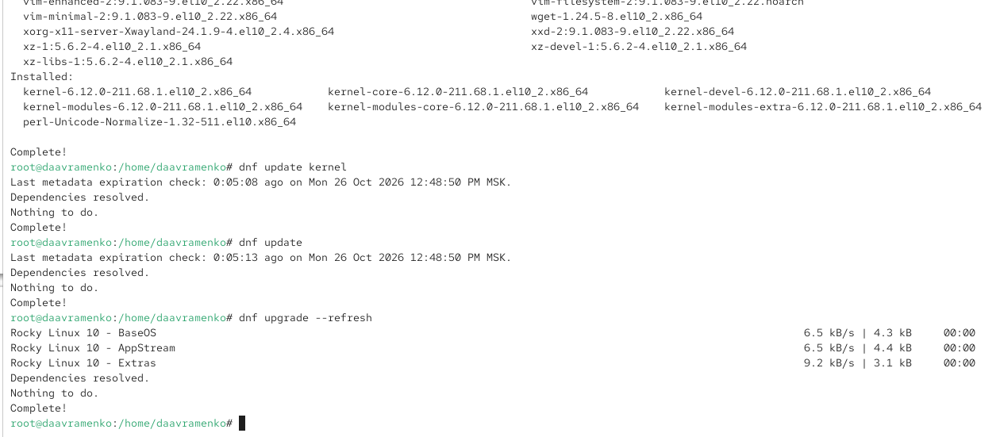
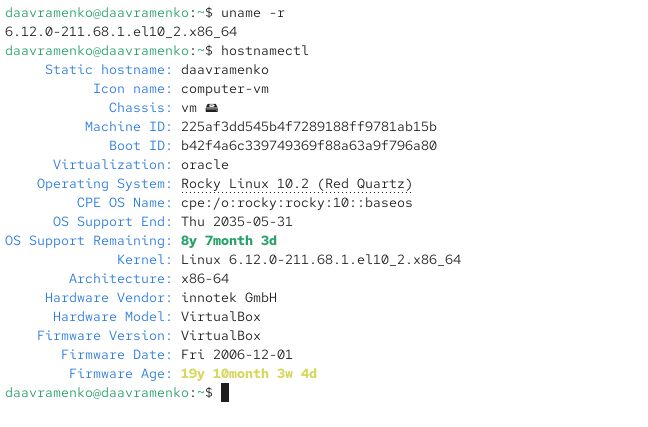

---
## Author
author:
  name: Авраменко Давид Андреевич
  email: 1032251973@rudn.ru
  affiliation:
    - name: Российский университет дружбы народов
      country: Российская Федерация
      postal-code: 117198
      city: Москва
      address: ул. Миклухо-Маклая, д. 6

## Title
title: Лабораторная работа №10
subtitle: Основы работы с модулями ядра операционной системы
license: CC BY
date: today
date-format: "YYYY-MM-DD"
---

---
## Author
author:
  name: Авраменко Давид Андреевич
  email: 1032251973@rudn.ru
  affiliation:
    - name: Российский университет дружбы народов
      country: Российская Федерация
      postal-code: 117198
      city: Москва
      address: ул. Миклухо-Маклая, д. 6

## Title
title: Лабораторная работа №10
subtitle: Основы работы с модулями ядра операционной системы
license: CC BY
date: today
date-format: "YYYY-MM-DD"
---

# Цели и задачи работы

## Цель лабораторной работы

Получить практические навыки управления модулями ядра операционной системы Linux, изучить способы их загрузки, выгрузки и настройки параметров.

Освоить просмотр информации о модулях ядра и их зависимостях, управление модулями из командной строки, а также процедуру обновления ядра операционной системы Rocky Linux.

# Процесс выполнения лабораторной работы

## Просматриваю устройства системы и используемые модули ядра

{ #fig:001 width=70% height=70% }

## Просматриваю список загруженных модулей ядра

{ #fig:002 width=70% height=70% }

## Загружаю модуль ext4 и изучаю его характеристики

{ #fig:003 width=70% height=70% }

## Проверяю возможность выгрузки модулей ext4 и xfs

{ #fig:004 width=70% height=70% }

## Загружаю модуль bluetooth и просматриваю сведения о нём

{ #fig:005 width=70% height=70% }

## Изучаю параметры модуля bluetooth и выполняю его выгрузку

{ #fig:006 width=70% height=70% }

## Проверяю текущую версию ядра и доступные обновления

{ #fig:007 width=70% height=70% }

## Обновляю репозитории и просматриваю список обновляемых пакетов

{ #fig:008 width=70% height=70% }

## Завершаю обновление ядра и проверяю состояние пакетов

{ #fig:009 width=70% height=70% }

## Проверяю версию ядра и сведения о системе после перезагрузки

{ #fig:010 width=70% height=70% }

# Выводы по проделанной работе

## Вывод

В ходе лабораторной работы изучены основные механизмы управления модулями ядра Linux. С помощью команд `lspci -k` и `lsmod` получена информация об устройствах системы, используемых драйверах и загруженных модулях.

Выполнены загрузка и выгрузка модулей `ext4` и `bluetooth` с помощью команды `modprobe`. Изучены характеристики модулей, их зависимости и доступные параметры с использованием `modinfo`. Установлены причины возникновения ошибки при попытке выгрузки используемого системой модуля `xfs`.

Также выполнено обновление операционной системы Rocky Linux с помощью менеджера пакетов `dnf`. После перезагрузки командами `uname -r` и `hostnamectl` подтверждён успешный переход на новую версию ядра `6.12.0-211.68.1.el10_2.x86_64`.
