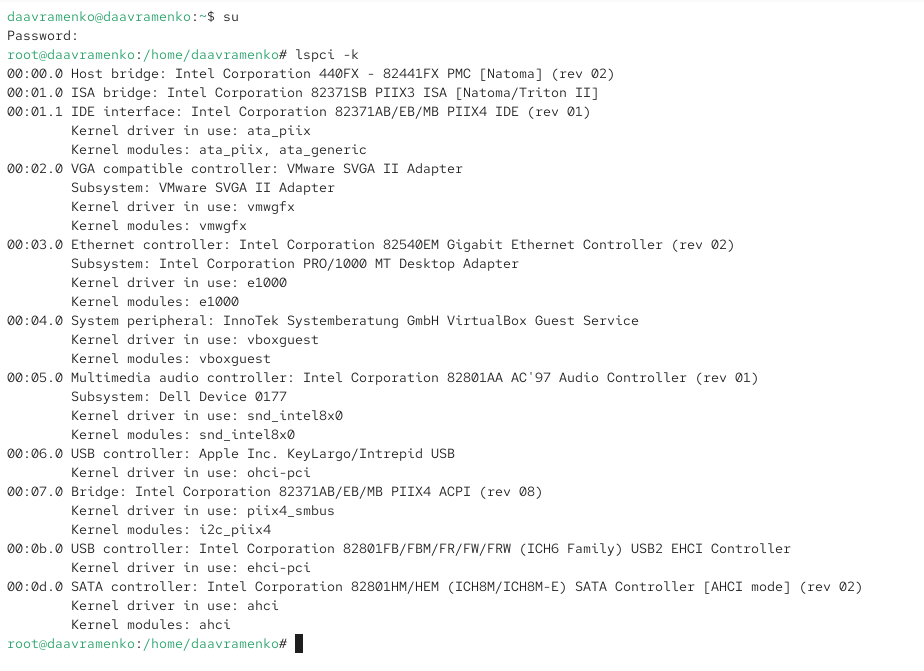
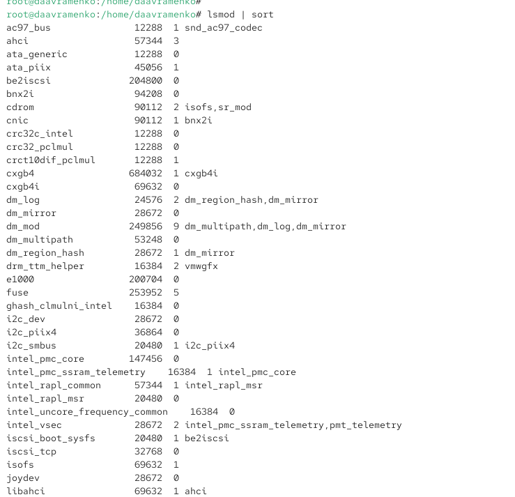
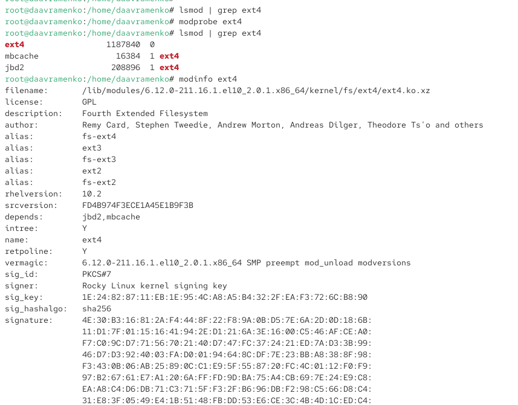
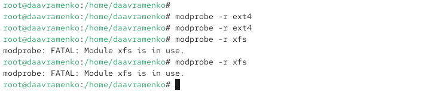
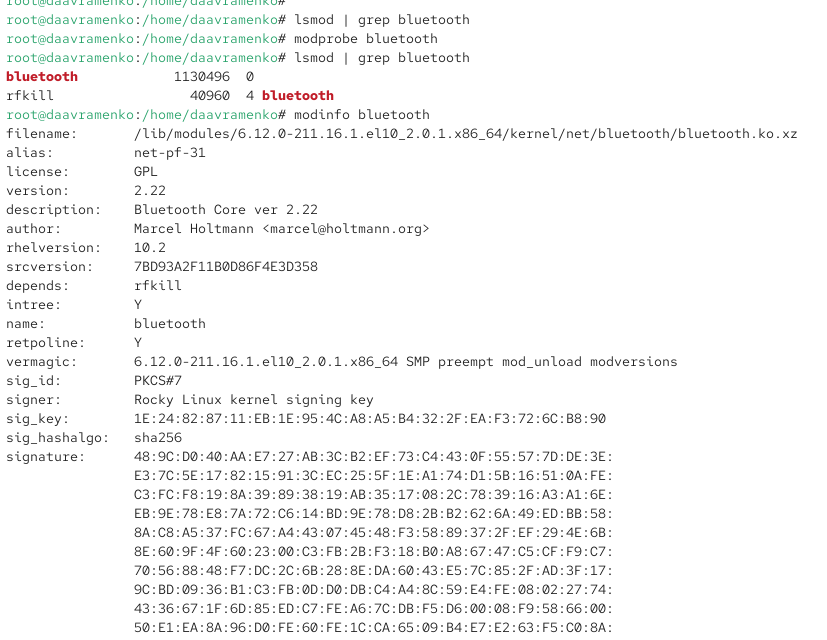
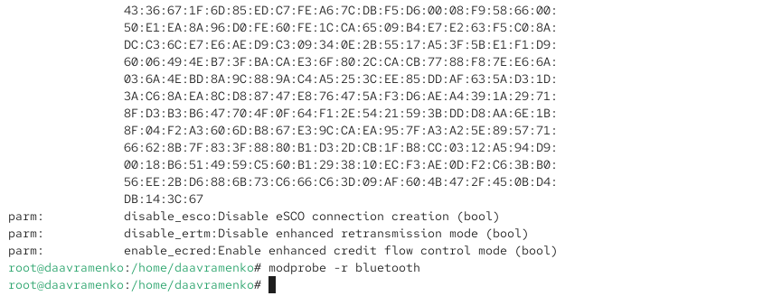
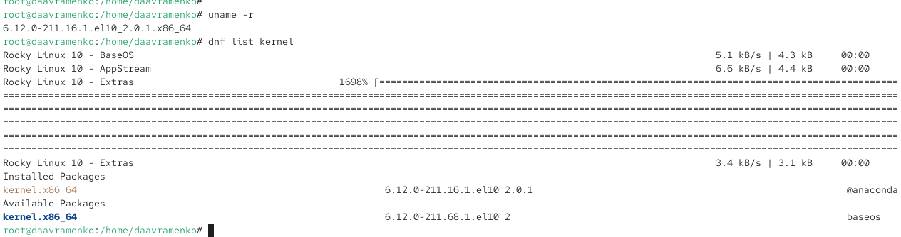
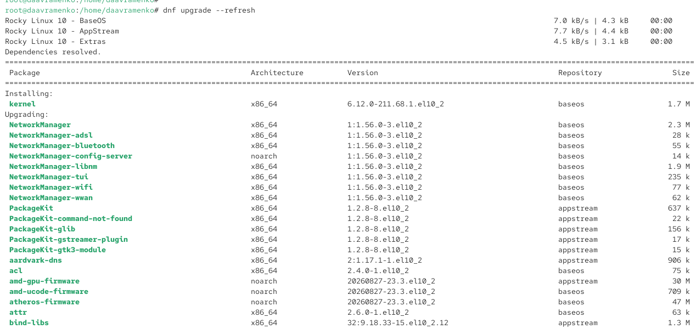
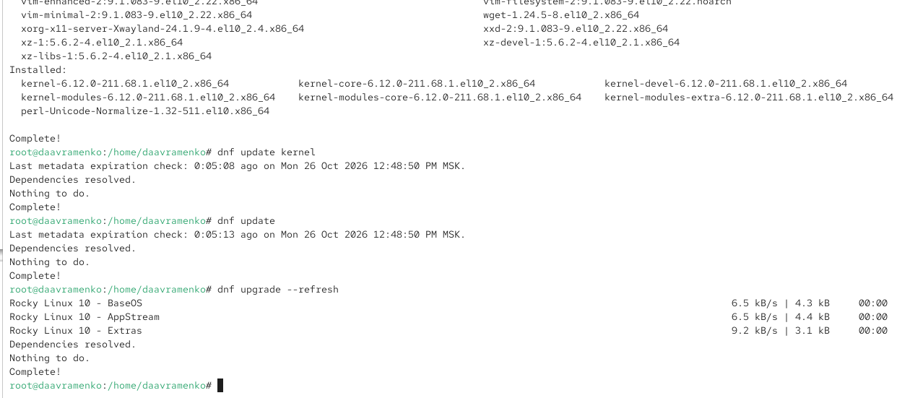
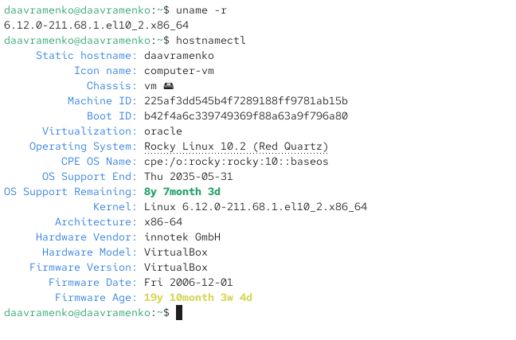

---
## Author
author:
  name: Авраменко Давид Андреевич
  email: 1032251973@rudn.ru
  affiliation:
    - name: Российский университет дружбы народов
      country: Российская Федерация
      postal-code: 117198
      city: Москва
      address: ул. Миклухо-Маклая, д. 6

## Title
title: "Отчёт по лабораторной работе №10"
subtitle: "Основы работы с модулями ядра операционной системы"
license: "CC BY"
---

# Цель работы

Получить навыки работы с утилитами управления модулями ядра операционной системы.

# Выполнение лабораторной работы

На виртуальной машине открываю терминал и командой `su` получаю права суперпользователя. Для просмотра устройств, подключённых к системе, и используемых ими модулей ядра выполняю команду `lspci -k`. В выводе отображаются устройства виртуальной машины, включая системные мосты Intel, контроллеры IDE и SATA, видеоадаптер VMware SVGA II Adapter, сетевой контроллер Intel 82540EM Gigabit Ethernet Controller, звуковой контроллер Intel 82801AA AC'97 и контроллеры USB. Строка `Kernel driver in use` указывает драйвер, используемый устройством в данный момент, а `Kernel modules` содержит список подходящих модулей ядра. Для видеоадаптера используется драйвер `vmwgfx`, для сетевого контроллера — `e1000`, для звукового устройства — `snd_intel8x0`, для SATA-контроллера — `ahci`. Также присутствует устройство VirtualBox Guest Service, использующее модуль `vboxguest`. Полученная информация позволяет определить аппаратные компоненты виртуальной машины и связанные с ними драйверы ядра (см. рис. [@fig-001]).

{ #fig-001 width=70% }

Для просмотра загруженных модулей ядра выполняю команду `lsmod | sort`. Команда `lsmod` выводит список модулей, находящихся в памяти ядра, а `sort` сортирует строки результата в алфавитном порядке. В выводе отображаются названия модулей, занимаемый ими объём памяти и количество использований. Среди загруженных модулей присутствуют `ahci`, отвечающий за работу SATA-контроллера, `e1000`, обеспечивающий работу сетевого адаптера, `ata_piix`, используемый для поддержки IDE-контроллера, и `snd_ac97_codec`, связанный со звуковой подсистемой. Также отображаются модули `dm_mod`, `dm_mirror` и `dm_multipath`, предназначенные для работы подсистемы Device Mapper. Последний столбец показывает модули или компоненты, использующие соответствующий модуль ядра. Например, модуль `snd_ac97_codec` используется модулем `ac97_bus`, а `dm_mirror` зависит от `dm_mod`. Полученный список позволяет определить активные модули и зависимости между ними (см. рис. [@fig-002]).

{ #fig-002 width=70% }

Для проверки наличия модуля файловой системы ext4 выполняю команду `lsmod | grep ext4`. Команда не выводит результатов, поскольку модуль `ext4` отсутствует в списке загруженных модулей. Затем выполняю `modprobe ext4` для его загрузки в ядро. Повторная проверка командой `lsmod | grep ext4` показывает модуль `ext4` размером `1187840` байт, а также связанные с ним модули `mbcache` и `jbd2`, используемые для кэширования и журналирования файловой системы. Для получения подробной информации выполняю `modinfo ext4`. В выводе параметр `filename` указывает путь `/lib/modules/6.12.0-211.16.1.el10_2.0.1.x86_64/kernel/fs/ext4/ext4.ko.xz`, `license: GPL` обозначает лицензию модуля, а `description: Fourth Extended Filesystem` указывает его назначение. Поле `author` содержит сведения о разработчиках, `alias` перечисляет поддерживаемые обозначения файловых систем ext2, ext3 и ext4, а `depends: jbd2,mbcache` показывает зависимости. Параметр `vermagic` содержит сведения о совместимости модуля с используемой версией ядра, `intree: Y` указывает на принадлежность к исходному дереву ядра, `retpoline: Y` — на наличие соответствующей защиты, а поля `signer`, `sig_key`, `sig_hashalgo` и `signature` содержат информацию о цифровой подписи. Строки `parm`, описывающие настраиваемые параметры загрузки, отсутствуют, следовательно, модуль `ext4` не предоставляет дополнительных параметров для передачи через `modprobe` (см. рис. [@fig-003]).

{ #fig-003 width=70% }

Для выгрузки модуля `ext4` выполняю команду `modprobe -r ext4`. Команда завершается без вывода сообщений об ошибках. Повторное выполнение также не сопровождается сообщениями, что свидетельствует об отсутствии препятствий для удаления модуля из памяти ядра. Затем пытаюсь выгрузить модуль файловой системы XFS командой `modprobe -r xfs`. Система выводит сообщение `modprobe: FATAL: Module xfs is in use.`, означающее, что модуль используется в данный момент и не может быть выгружен. Повторная попытка приводит к аналогичной ошибке. Это связано с тем, что ядро не допускает выгрузку модулей, необходимых для работы активных компонентов системы, в частности смонтированных файловых систем (см. рис. [@fig-004]).

{ #fig-004 width=70% }

Для изучения загрузки модулей ядра с параметрами сначала проверяю наличие модуля Bluetooth командой `lsmod | grep bluetooth`. Отсутствие результата означает, что модуль `bluetooth` не загружен. Выполняю команду `modprobe bluetooth`, после чего повторно проверяю список модулей. В выводе появляются `bluetooth` размером `1130496` байт и `rfkill` размером `40960` байт. Модуль `rfkill` обеспечивает программное управление состоянием беспроводных интерфейсов и используется модулем Bluetooth. Затем выполняю `modinfo bluetooth` для просмотра подробных характеристик модуля. Поле `filename` указывает расположение файла `bluetooth.ko.xz` в каталоге `/lib/modules`, `license: GPL` обозначает лицензию, `version: 2.22` — версию Bluetooth Core, а `description: Bluetooth Core ver 2.22` характеризует назначение модуля. В поле `author` указан разработчик Marcel Holtmann, в `depends` приведена зависимость `rfkill`, а в `vermagic` содержится информация о версии ядра, для которой собран модуль. Поля цифровой подписи подтверждают наличие подписи Rocky Linux (см. рис. [@fig-005]).

{ #fig-005 width=70% }

Продолжаю изучение вывода команды `modinfo bluetooth` и рассматриваю доступные параметры загрузки модуля. Параметр `disable_esco` позволяет запретить создание соединений eSCO, используемых для передачи синхронных аудиоданных по Bluetooth. Параметр `disable_ertm` отключает расширенный режим повторной передачи ERTM, предназначенный для повышения надёжности передачи данных. Параметр `enable_ecred` включает расширенный режим управления потоком на основе кредитов Enhanced Credit Flow Control. Все перечисленные параметры имеют тип `bool` и могут принимать значения `0` или `1`. Например, команда `modprobe bluetooth disable_ertm=1` позволяет загрузить модуль с отключённым режимом ERTM, если модуль предварительно не загружен. В выполненной проверке модуль был загружен без дополнительных параметров. После изучения его характеристик выполняю `modprobe -r bluetooth` для выгрузки модуля. Команда завершается без сообщений об ошибках, что указывает на успешное выполнение операции (см. рис. [@fig-006]).

{ #fig-006 width=70% }

Для проверки версии используемого ядра выполняю команду `uname -r`. Система выводит значение `6.12.0-211.16.1.el10_2.0.1.x86_64`, которое обозначает текущую версию ядра Linux для архитектуры x86-64. Затем выполняю `dnf list kernel` для просмотра установленных и доступных пакетов ядра. Менеджер пакетов обращается к репозиториям Rocky Linux 10 `BaseOS`, `AppStream` и `Extras`. В разделе `Installed Packages` отображается установленный пакет `kernel.x86_64` версии `6.12.0-211.16.1.el10_2.0.1`, а в разделе `Available Packages` доступна более новая версия `6.12.0-211.68.1.el10_2`. Сравнение версий показывает возможность обновления ядра операционной системы до актуальной версии из подключённых репозиториев (см. рис. [@fig-007]).

{ #fig-007 width=70% }

Перед обновлением ядра выполняю команду `dnf upgrade --refresh`, которая принудительно обновляет метаданные подключённых репозиториев и проверяет наличие обновлений установленных пакетов. После получения информации из репозиториев `BaseOS`, `AppStream` и `Extras` менеджер пакетов разрешает зависимости и формирует список изменений. В разделе `Installing` отображается новое ядро `kernel` версии `6.12.0-211.68.1.el10_2` для архитектуры `x86_64`. В разделе `Upgrading` перечислены пакеты, для которых доступны обновления, включая компоненты `NetworkManager`, `NetworkManager-bluetooth`, `NetworkManager-wifi`, `PackageKit`, `acl`, `bind-libs` и другие системные библиотеки и утилиты. В таблице указываются архитектура пакета, устанавливаемая версия, репозиторий и размер загрузки. Обновление системы необходимо для устранения известных ошибок, получения исправлений безопасности и обеспечения совместимости компонентов операционной системы с новой версией ядра (см. рис. [@fig-008]).

{ #fig-008 width=70% }

После выполнения обновления проверяю результат установки пакетов ядра. В выводе команды `dnf upgrade --refresh` отображается сообщение `Complete!`, подтверждающее завершение обновления. В разделе `Installed` перечислены пакеты `kernel`, `kernel-core`, `kernel-devel`, `kernel-modules`, `kernel-modules-core` и `kernel-modules-extra` версии `6.12.0-211.68.1.el10_2.x86_64`. Основной пакет `kernel` обеспечивает установку ядра, `kernel-core` содержит его основные компоненты, `kernel-devel` предоставляет файлы для сборки дополнительных модулей, а пакеты `kernel-modules`, `kernel-modules-core` и `kernel-modules-extra` содержат различные группы модулей и драйверов. Затем выполняю команду `dnf update kernel` для проверки обновлений ядра. Система выводит `Nothing to do.` и `Complete!`, подтверждая отсутствие дополнительных доступных обновлений. Аналогичные сообщения получаю после выполнения `dnf update` и повторной команды `dnf upgrade --refresh`. Это означает, что все доступные обновления из подключённых репозиториев уже установлены (см. рис. [@fig-009]).

{ #fig-009 width=70% }

После установки обновлений перезагружаю виртуальную машину для запуска операционной системы с новой версией ядра. Открываю терминал и выполняю команду `uname -r`. В выводе получаю `6.12.0-211.68.1.el10_2.x86_64`, что подтверждает успешный запуск обновлённого ядра вместо ранее использовавшейся версии `6.12.0-211.16.1.el10_2.0.1.x86_64`. Затем выполняю команду `hostnamectl` для просмотра сведений об операционной системе и окружении. В выводе `Static hostname: daavramenko` указывает имя компьютера, `Operating System: Rocky Linux 10.2 (Red Quartz)` — название и версию дистрибутива, `Kernel: Linux 6.12.0-211.68.1.el10_2.x86_64` — используемое ядро, а `Architecture: x86-64` — архитектуру системы. Параметры `Virtualization: oracle`, `Hardware Model: VirtualBox` и `Hardware Vendor: innotek GmbH` подтверждают, что система работает в виртуальной среде VirtualBox. Также отображаются идентификаторы машины и текущей загрузки, сведения о прошивке и дате окончания поддержки операционной системы. Полученные результаты подтверждают успешное обновление ядра и запуск Rocky Linux с установленной версией `6.12.0-211.68.1.el10_2.x86_64` (см. рис. [@fig-010]).

{ #fig-010 width=70% }

# Вывод

В ходе лабораторной работы были изучены основные механизмы управления модулями ядра и обновления ядра операционной системы Rocky Linux. Рассмотрены способы просмотра подключённых устройств, определения используемых ими драйверов, загрузки и выгрузки модулей, а также получения подробной информации об их характеристиках и параметрах.

С помощью команды `lspci -k` получена информация об устройствах виртуальной машины и связанных с ними модулях ядра. Командой `lsmod` просмотрен список загруженных модулей, а с помощью `modprobe` выполнена загрузка модуля файловой системы `ext4`. Команда `modinfo` позволила изучить его характеристики, зависимости и сведения о совместимости с текущей версией ядра.

Также изучена процедура выгрузки модулей. Установлено, что модуль `ext4` может быть выгружен при отсутствии активного использования, тогда как попытка выгрузки `xfs` приводит к ошибке `Module xfs is in use`, поскольку модуль задействован операционной системой.

На примере модуля `bluetooth` рассмотрена возможность загрузки модулей с дополнительными параметрами. Изучено назначение параметров `disable_esco`, `disable_ertm` и `enable_ecred`, позволяющих управлять отдельными функциями Bluetooth.

В заключительной части работы выполнено обновление операционной системы и ядра с помощью менеджера пакетов `dnf`. После установки обновлений и перезагрузки системы командами `uname -r` и `hostnamectl` подтверждён переход с версии ядра `6.12.0-211.16.1.el10_2.0.1.x86_64` на `6.12.0-211.68.1.el10_2.x86_64`.

В результате работы получены практические навыки управления модулями ядра Linux, определения их зависимостей и параметров, диагностики ошибок при выгрузке модулей, а также установки обновлений ядра операционной системы.

# Контрольные вопросы

1. **Какая команда показывает текущую версию ядра, которая используется на вашей системе?**

Для просмотра текущей версии ядра операционной системы необходимо выполнить команду:

`uname -r`

Параметр `-r` выводит релиз запущенного ядра Linux. Например, после обновления системы команда возвращает значение `6.12.0-211.68.1.el10_2.x86_64`.

2. **Как можно посмотреть более подробную информацию о текущей версии ядра операционной системы?**

Для просмотра подробной информации о ядре используется команда:

`uname -a`

Параметр `-a` выводит все доступные сведения, включая название ядра, имя компьютера, релиз и версию ядра, архитектуру процессора и тип операционной системы.

Дополнительно можно использовать команду `hostnamectl`, которая отображает сведения об операционной системе, версии ядра, архитектуре и среде виртуализации.

3. **Какая команда показывает список загруженных модулей ядра?**

Для просмотра списка загруженных модулей ядра необходимо выполнить команду:

`lsmod`

Команда выводит таблицу с названиями модулей, занимаемым ими объёмом памяти и количеством использований.

Для сортировки списка по алфавиту используется команда `lsmod | sort`, а для поиска конкретного модуля можно выполнить `lsmod | grep ext4`.

4. **Какая команда позволяет вам определять параметры модуля ядра?**

Для получения информации о параметрах модуля ядра используется команда:

`modinfo <имя_модуля>`

Например, для просмотра характеристик модуля Bluetooth необходимо выполнить:

`modinfo bluetooth`

Команда отображает путь к файлу модуля, описание, версию, лицензию, зависимости, сведения о цифровой подписи и поддерживаемые параметры.

5. **Как выгрузить модуль ядра?**

Для выгрузки модуля ядра используется команда:

`modprobe -r <имя_модуля>`

Например, для выгрузки модуля файловой системы ext4 необходимо выполнить:

`modprobe -r ext4`

Параметр `-r` указывает на необходимость удаления модуля из памяти ядра. Выгрузка возможна, если модуль не используется другими компонентами системы.

6. **Что вы можете сделать, если получите сообщение об ошибке при попытке выгрузить модуль ядра?**

Если при выгрузке модуля появляется ошибка `Module is in use`, необходимо определить, какие процессы или другие модули используют его.

Для проверки зависимостей можно выполнить команду:

`lsmod | grep <имя_модуля>`

Также можно использовать `modinfo <имя_модуля>` для просмотра информации о модуле.

После этого необходимо остановить использующие модуль службы, освободить связанные с ним ресурсы или выгрузить зависимые модули, если это безопасно.

Например, модуль `xfs` нельзя выгрузить, пока он обслуживает смонтированную файловую систему. Если модуль используется корневой файловой системой, его выгрузка во время обычной работы системы невозможна.

После устранения причины блокировки можно повторить команду `modprobe -r`.

7. **Как определить, какие параметры модуля ядра поддерживаются?**

Для просмотра поддерживаемых параметров модуля используется команда:

`modinfo -p <имя_модуля>`

Например:

`modinfo -p bluetooth`

Параметр `-p` выводит только список настраиваемых параметров модуля и их описания.

Для модуля `bluetooth` доступны параметры `disable_esco`, `disable_ertm` и `enable_ecred`. Они позволяют управлять отдельными механизмами Bluetooth.

При загрузке модуля значения параметров можно указать непосредственно в команде, например:

`modprobe bluetooth disable_ertm=1`

В данном случае модуль загружается с отключённым режимом расширенной повторной передачи ERTM.

8. **Как установить новую версию ядра?**

Для установки новой версии ядра в Rocky Linux используется менеджер пакетов `dnf`.

Сначала необходимо проверить текущую версию ядра:

`uname -r`

Затем просмотреть установленные и доступные пакеты ядра:

`dnf list kernel`

Для обновления метаданных репозиториев и установленных пакетов выполняется команда:

`dnf upgrade --refresh`

После этого можно выполнить обновление ядра:

`dnf update kernel`

Для обновления остальных пакетов операционной системы используется команда:

`dnf update`

После завершения установки необходимо перезагрузить систему командой `reboot` и при необходимости выбрать новое ядро в меню загрузчика GRUB.

Проверить успешность обновления можно командами:

`uname -r`

`hostnamectl`

Если в выводе отображается новая версия ядра, значит обновление выполнено успешно и операционная система работает с обновлённым ядром.

# Список литературы

1. Linux man-pages. [modprobe(8) — Add and Remove Modules from the Linux Kernel](https://man7.org/linux/man-pages/man8/modprobe.8.html). — Справочное руководство по загрузке и выгрузке модулей ядра Linux, управлению зависимостями и передаче параметров при загрузке.

2. Linux man-pages. [lsmod(8) — Show the Status of Modules in the Linux Kernel](https://man7.org/linux/man-pages/man8/lsmod.8.html). — Документация по просмотру загруженных модулей ядра, анализу их использования и зависимостей.

3. Linux man-pages. [modinfo(8) — Show Information About a Linux Kernel Module](https://man7.org/linux/man-pages/man8/modinfo.8.html). — Справочное руководство по получению информации о модулях ядра, их версиях, лицензиях, зависимостях и поддерживаемых параметрах.

4. Red Hat, Inc. [Red Hat Enterprise Linux 10. Managing, Monitoring, and Updating the Kernel](https://docs.redhat.com/en/documentation/red_hat_enterprise_linux/10/html-single/managing_monitoring_and_updating_the_kernel/index). — Официальная документация по управлению ядром Linux, установке новых версий, обновлению пакетов ядра и настройке загрузки операционной системы.

5. Rocky Linux Documentation. [DNF Package Manager](https://docs.rockylinux.org/guides/package_management/dnf_package_manager/). — Руководство по управлению пакетами в Rocky Linux, работе с репозиториями, проверке доступных обновлений и обновлению операционной системы с помощью менеджера пакетов DNF.
