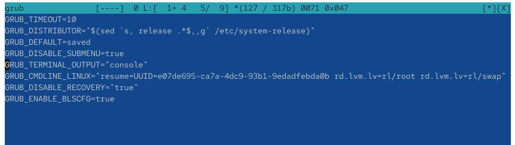
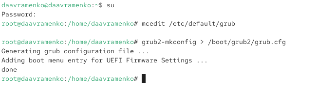
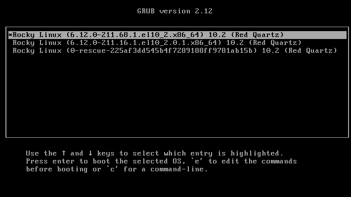
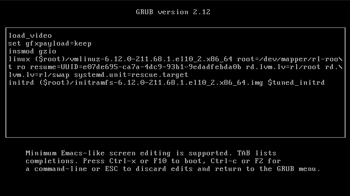
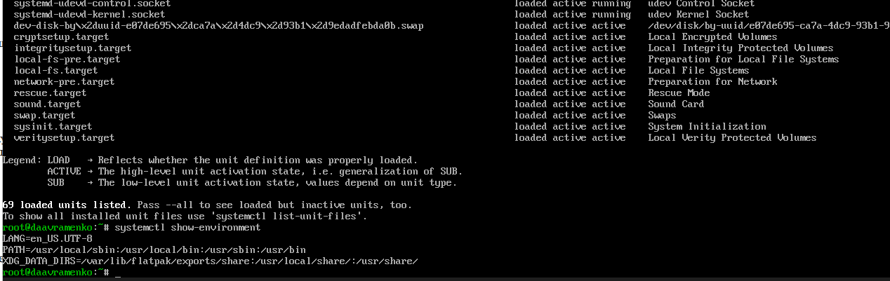
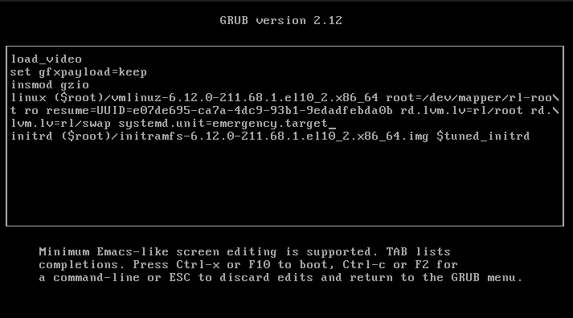
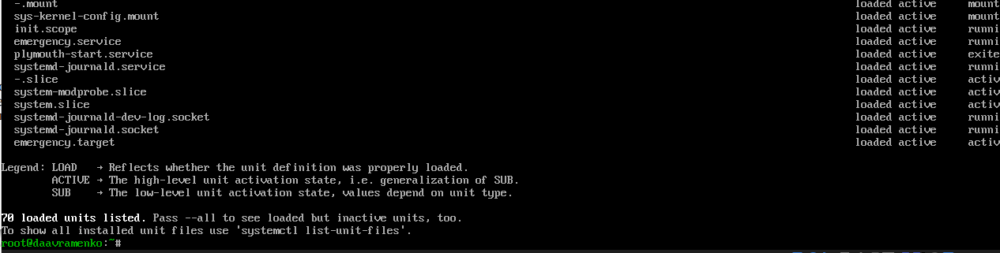
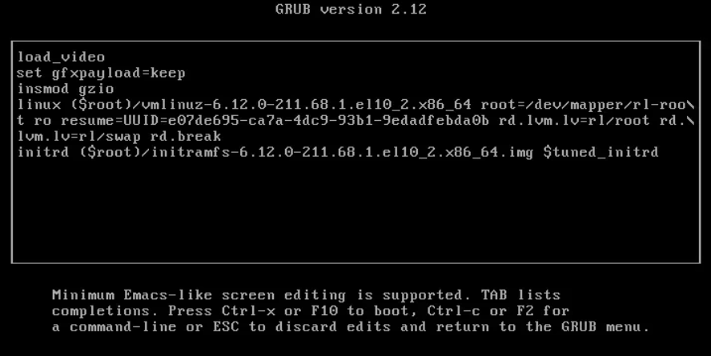
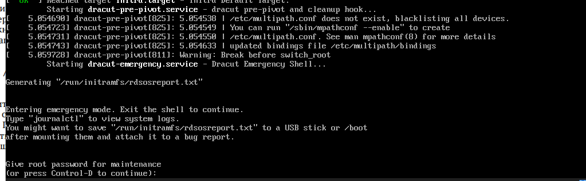

---
## Author
author:
  name: Авраменко Давид Андреевич
  email: 1032251973@rudn.ru
  affiliation:
    - name: Российский университет дружбы народов
      country: Российская Федерация
      postal-code: 117198
      city: Москва
      address: ул. Миклухо-Маклая, д. 6

## Title
title: Лабораторная работа №11
subtitle: Управление загрузкой системы
license: CC BY
date: today
date-format: "YYYY-MM-DD"
---

# Цели и задачи работы

## Цель лабораторной работы

Получить практические навыки настройки загрузчика GRUB2, изменения параметров загрузки операционной системы Linux и сохранения изменений в конфигурационном файле.

Изучить способы устранения неполадок загрузки с использованием режимов `rescue.target` и `emergency.target`, а также процедуру восстановления доступа к учётной записи суперпользователя в операционной системе Rocky Linux.

# Процесс выполнения лабораторной работы

## Изменяю параметры загрузчика GRUB2

{ #fig:001 width=70% height=70% }

## Формирую новый конфигурационный файл GRUB2

{ #fig:002 width=70% height=70% }

## Проверяю отображение меню загрузчика после изменения конфигурации

{ #fig:003 width=70% height=70% }

## Настраиваю загрузку системы в режиме восстановления rescue.target

{ #fig:004 width=70% height=70% }

## Просматриваю системные единицы и переменные окружения

{ #fig:005 width=70% height=70% }

## Настраиваю загрузку системы в аварийном режиме emergency.target

{ #fig:006 width=70% height=70% }

## Просматриваю системные единицы в аварийном режиме

{ #fig:007 width=70% height=70% }

## Добавляю параметр rd.break для восстановления доступа к системе

{ #fig:008 width=70% height=70% }

## Проверяю возможность сброса пароля суперпользователя

{ #fig:009 width=70% height=70% }

# Выводы по проделанной работе

## Вывод

В ходе лабораторной работы изучены основные механизмы настройки загрузчика GRUB2 и управления процессом загрузки операционной системы Rocky Linux. Выполнено изменение параметра `GRUB_TIMEOUT` в файле `/etc/default/grub` и обновление конфигурации с помощью команды `grub2-mkconfig`. После перезагрузки проверена работа меню загрузчика.

Изучены режимы восстановления `rescue.target` и `emergency.target`. С помощью команд `systemctl list-units` и `systemctl show-environment` получена информация о загруженных системных единицах и переменных окружения.

Также рассмотрена процедура восстановления пароля пользователя `root` с использованием параметра `rd.break`. После прерывания загрузки система запросила действующий пароль суперпользователя. Поскольку по условию задания пароль забыт, выполнить его сброс по предложенной инструкции не удалось.

В результате получены практические навыки изменения конфигурации GRUB2, редактирования параметров запуска ядра, использования режимов восстановления и диагностики проблем при загрузке операционной системы.
