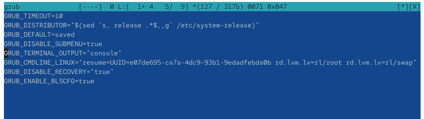
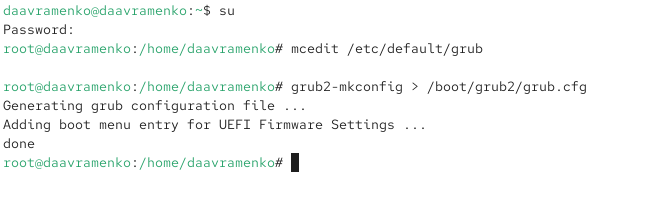
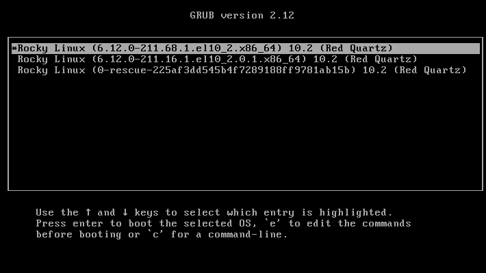
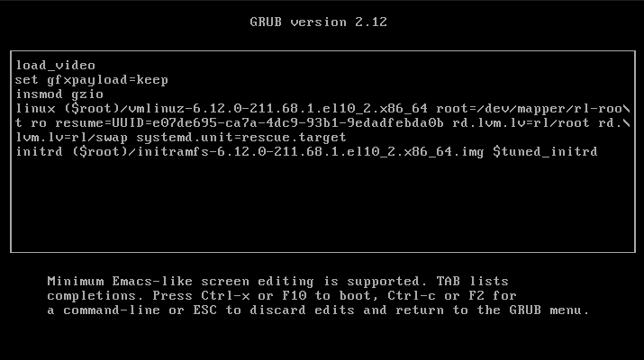
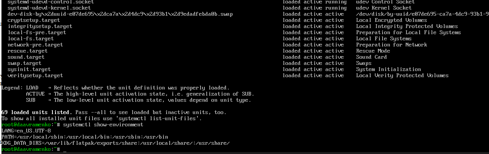
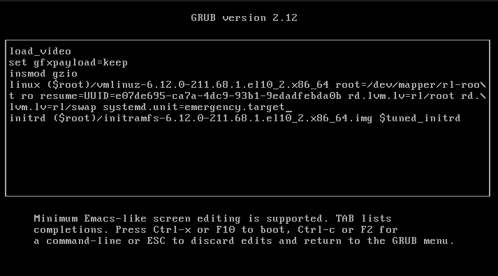
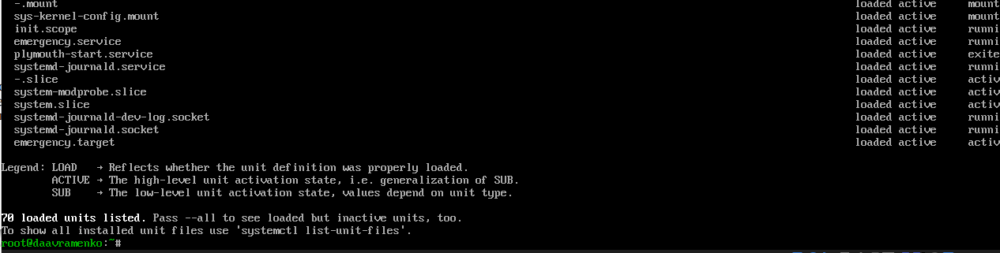
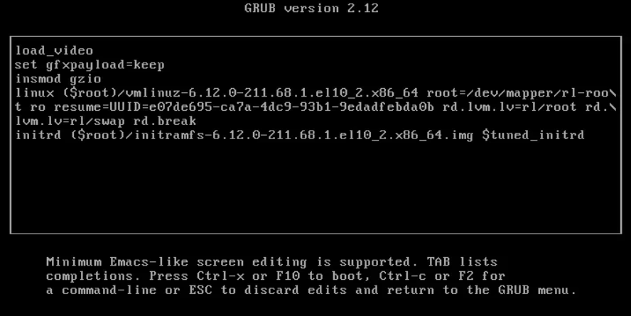
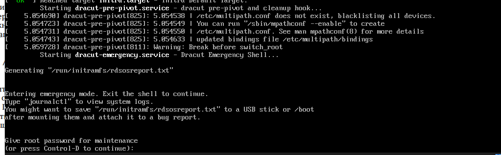

---
## Author
author:
  name: Авраменко Давид Андреевич
  email: 1032251973@rudn.ru
  affiliation:
    - name: Российский университет дружбы народов
      country: Российская Федерация
      postal-code: 117198
      city: Москва
      address: ул. Миклухо-Маклая, д. 6

## Title
title: "Отчёт по лабораторной работе №11"
subtitle: "Управление загрузкой системы"
license: "CC BY"
---

# Цель работы

Получить навыки работы с загрузчиком системы GRUB2.

# Выполнение лабораторной работы

Для изменения параметров загрузчика GRUB2 открываю терминал и командой `su -` получаю права суперпользователя. Затем в редакторе `mcedit` открываю конфигурационный файл `/etc/default/grub` и устанавливаю параметр `GRUB_TIMEOUT=10`, определяющий время отображения меню загрузки в течение 10 секунд. Параметр `GRUB_DEFAULT=saved` указывает на использование сохранённой записи загрузки, а `GRUB_DISABLE_SUBMENU=true` отключает вложенные меню. В строке `GRUB_CMDLINE_LINUX` находятся параметры запуска ядра, включая `resume=UUID` и `rd.lvm.lv`, используемые для работы с системными разделами. Параметры `rhgb` и `quiet`, скрывающие сообщения загрузки, отсутствуют. После изменения сохраняю конфигурационный файл (см. рис. [@fig-001]).

{ #fig-001 width=70% }

Для применения изменений выполняю команду `grub2-mkconfig > /boot/grub2/grub.cfg`. Утилита `grub2-mkconfig` формирует новую конфигурацию загрузчика, а оператор `>` записывает результат в файл `/boot/grub2/grub.cfg`. В терминале отображаются сообщения `Generating grub configuration file ...` и `Adding boot menu entry for UEFI Firmware Settings ...`. Появление сообщения `done` подтверждает успешное завершение операции. Следовательно, изменённые параметры сохранены и будут применены при следующей загрузке системы (см. рис. [@fig-002]).

{ #fig-002 width=70% }

Для проверки изменений перезагружаю виртуальную машину. На экране появляется меню `GRUB version 2.12`, содержащее несколько вариантов загрузки Rocky Linux 10.2. Доступны записи с ядрами `6.12.0-211.68.1.el10_2.x86_64` и `6.12.0-211.16.1.el10_2.0.1.x86_64`, а также аварийный образ `0-rescue`. Первая запись выбрана по умолчанию. Для перемещения между записями используются клавиши со стрелками, `Enter` запускает выбранное ядро, а клавиша `e` открывает редактор параметров загрузки. Появление меню подтверждает корректную работу GRUB2 после изменения конфигурации (см. рис. [@fig-003]).

{ #fig-003 width=70% }

Для изучения режима восстановления выбираю текущую версию ядра и нажимаю `e`, переходя в редактор GRUB2. Нахожу строку, начинающуюся с `linux ($root)/vmlinuz-`, и добавляю в её конец параметр `systemd.unit=rescue.target`. Он указывает системе необходимость загрузки в режиме восстановления с ограниченным набором служб. В строке также присутствуют параметры `root=/dev/mapper/rl-root`, `ro` и `rd.lvm.lv`, необходимые для подключения корневой файловой системы. Параметры `rhgb` и `quiet` отсутствуют. Для продолжения загрузки с изменёнными параметрами нажимаю `Ctrl + x`. Внесённые изменения действуют только для текущего запуска системы (см. рис. [@fig-004]).

{ #fig-004 width=70% }

После перехода в режим восстановления выполняю команду `systemctl list-units` для просмотра загруженных системных единиц. В выводе отображаются службы, сокеты, точки монтирования и целевые состояния системы. Среди них присутствуют `rescue.target`, `local-fs.target`, `swap.target` и `sysinit.target`. Всего отображается 69 загруженных единиц. Затем выполняю команду `systemctl show-environment`, которая выводит переменные окружения менеджера `systemd`. В результате присутствуют `LANG=en_US.UTF-8`, определяющая локаль системы, `PATH`, содержащая пути поиска исполняемых файлов, и `XDG_DATA_DIRS`, указывающая каталоги пользовательских данных. Полученная информация подтверждает загрузку базового системного окружения (см. рис. [@fig-005]).

{ #fig-005 width=70% }

Для проверки аварийного режима перезагружаю систему и повторно открываю редактор GRUB2 клавишей `e`. В строку запуска ядра добавляю параметр `systemd.unit=emergency.target`, который обеспечивает загрузку минимального системного окружения. В отличие от `rescue.target`, аварийный режим предназначен для устранения критических неисправностей и запускает только необходимые компоненты системы. Остальные параметры ядра оставляю без изменений. После редактирования нажимаю `Ctrl + x` для продолжения загрузки (см. рис. [@fig-006]).

{ #fig-006 width=70% }

После загрузки в аварийном режиме выполняю команду `systemctl list-units`. В выводе отображаются базовые системные единицы, включая `emergency.target`, `emergency.service`, `init.scope`, `system.slice` и `systemd-journald.service`. Всего отображается 70 загруженных единиц. Несмотря на небольшое увеличение количества записей по сравнению с режимом восстановления, аварийный режим ограничивает запуск обычных служб и предоставляет минимальное окружение для диагностики системы. Полученный результат позволяет изучить состав компонентов, доступных при аварийной загрузке (см. рис. [@fig-007]).

{ #fig-007 width=70% }

Для изучения процедуры сброса пароля суперпользователя перезагружаю виртуальную машину и в меню GRUB2 нажимаю `e` для редактирования параметров текущего ядра. В конец строки, начинающейся с `linux ($root)/vmlinuz-`, добавляю параметр `rd.break`. Он предназначен для прерывания загрузки на этапе работы `initramfs`, перед переключением на основную корневую файловую систему. Это позволяет получить доступ к среде восстановления и выполнить необходимые административные действия. После изменения параметров нажимаю `Ctrl + x` для продолжения загрузки (см. рис. [@fig-008]).

{ #fig-008 width=70% }

После загрузки с параметром `rd.break` система останавливается на этапе `initramfs`. В выводе появляется сообщение `Warning: Break before switch_root`, подтверждающее прерывание процесса загрузки до переключения на основную корневую файловую систему. Затем запускается служба `dracut-emergency.service`, а система переходит в аварийный режим. Однако вместо предоставления командной оболочки без авторизации появляется запрос `Give root password for maintenance (or press Control-D to continue):`, требующий ввода действующего пароля пользователя `root`. По условию задания пароль суперпользователя забыт, поэтому пройти авторизацию невозможно. Следовательно, получить доступ к командной оболочке и выполнить дальнейшие действия по сбросу пароля, включая `mount -o remount,rw /sysroot`, `chroot /sysroot` и `passwd`, не удаётся. Таким образом, параметр `rd.break` позволяет остановить загрузку на необходимом этапе, но в используемой конфигурации системы запрашивается пароль `root`, из-за чего завершить процедуру его сброса по предложенной инструкции невозможно (см. рис. [@fig-009]).

{ #fig-009 width=70% }

# Вывод

В ходе лабораторной работы были изучены основные механизмы настройки загрузчика GRUB2, изменения параметров запуска операционной системы Rocky Linux, а также способы устранения неполадок загрузки и восстановления доступа к системе.

В первой части работы выполнено редактирование файла `/etc/default/grub`, в котором параметр `GRUB_TIMEOUT` установлен равным 10 секундам. Для применения изменений использована команда `grub2-mkconfig > /boot/grub2/grub.cfg`, обеспечивающая обновление конфигурации загрузчика. После перезагрузки системы проверено отображение меню GRUB2 с доступными версиями ядра.

Далее изучены режимы восстановления `rescue.target` и `emergency.target`, запускаемые путём добавления соответствующих параметров в строку загрузки ядра через редактор GRUB2. С помощью команды `systemctl list-units` просмотрены загруженные системные единицы, а команда `systemctl show-environment` позволила получить информацию о переменных окружения. Установлено, что аварийный режим предназначен для работы с минимальным системным окружением.

В заключительной части рассмотрена процедура сброса пароля пользователя `root` с использованием параметра `rd.break`. После прерывания загрузки на этапе `initramfs` система перешла в аварийный режим, однако потребовала действующий пароль суперпользователя. Поскольку по условию задания пароль забыт, получить доступ к командной оболочке и завершить процедуру сброса пароля не удалось.

В результате работы получены практические навыки настройки GRUB2, обновления его конфигурации, изменения параметров запуска ядра и использования режимов восстановления. Также изучены особенности аварийной загрузки и ограничения процедуры восстановления доступа к системе.

# Контрольные вопросы

1. **Какой файл конфигурации следует изменить для применения общих изменений в GRUB2?**

Для внесения общих изменений в настройки загрузчика GRUB2 необходимо отредактировать файл:

`/etc/default/grub`

В этом файле находятся основные параметры загрузчика, включая `GRUB_TIMEOUT`, определяющий время ожидания выбора загрузочной записи, `GRUB_DEFAULT`, задающий запись по умолчанию, и `GRUB_CMDLINE_LINUX`, содержащий параметры запуска ядра.

2. **Как называется конфигурационный файл GRUB2, в котором вы применяете изменения для GRUB2?**

Основной конфигурационный файл загрузчика GRUB2 располагается по пути:

`/boot/grub2/grub.cfg`

Этот файл содержит настройки загрузочного меню, записи операционных систем и параметры запуска ядра. Он формируется автоматически на основании файла `/etc/default/grub` и других источников конфигурации. Непосредственное редактирование `grub.cfg` не рекомендуется, поскольку изменения могут быть перезаписаны при повторном формировании конфигурации.

3. **После внесения изменений в конфигурацию GRUB2, какую команду вы должны выполнить, чтобы изменения сохранились и воспринялись при загрузке системы?**

После изменения настроек в файле `/etc/default/grub` необходимо выполнить команду:

`grub2-mkconfig -o /boot/grub2/grub.cfg`

Утилита `grub2-mkconfig` создаёт обновлённую конфигурацию загрузчика, а параметр `-o` указывает путь к выходному файлу.

Также можно использовать команду:

`grub2-mkconfig > /boot/grub2/grub.cfg`

В обоих случаях обновлённая конфигурация записывается в файл `/boot/grub2/grub.cfg`. Для проверки применения изменений необходимо перезагрузить операционную систему.

# Список литературы

1. GNU Project. [GNU GRUB Manual — Simple Configuration](https://www.gnu.org/software/grub/manual/grub/html_node/Simple-configuration.html). — Официальное руководство по настройке загрузчика GRUB2, редактированию файла `/etc/default/grub`, управлению параметрами `GRUB_TIMEOUT`, `GRUB_DEFAULT` и формированию загрузочного меню.

2. Red Hat, Inc. [Red Hat Enterprise Linux 10. Configuring Kernel Command-Line Parameters](https://docs.redhat.com/en/documentation/red_hat_enterprise_linux/10/html/managing_monitoring_and_updating_the_kernel/configuring-kernel-command-line-parameters). — Документация по изменению параметров запуска ядра Linux, редактированию записей GRUB2 и обновлению конфигурации загрузчика с помощью команды `grub2-mkconfig`.

3. freedesktop.org. [systemd.special — Special Systemd Units](https://www.freedesktop.org/software/systemd/man/262/systemd.special.html). — Справочное руководство по специальным системным единицам `systemd`, включая режимы восстановления `rescue.target` и `emergency.target`, их назначение и особенности загрузки системы.

4. Red Hat, Inc. [Red Hat Enterprise Linux 9. Configuring Basic System Settings](https://docs.redhat.com/en/documentation/red_hat_enterprise_linux/9/epub/configuring_basic_system_settings/index). — Официальная документация по администрированию системы, восстановлению доступа к учётной записи суперпользователя, сбросу пароля `root` с использованием параметра `rd.break` и работе с SELinux.
